# KIPU'S ERP — Flujos Operativos Estilo Bizagi para Servidor UML

Este documento presenta los **11 flujos de procesos unificados** de **KIPU'S ERP**, adaptados al estilo de diagramas de procesos **BPMN / Bizagi**:
- **Pasos cortos, concisos y directos**, basados en la operación real de la pantalla.
- **Cuadros coloreados con semántica BPMN**:
  - 🟢 **Verde (`#E8F8F5`):** Inicio, confirmaciones de éxito y emisión de comprobantes.
  - 🔵 **Azul (`#EBF5FB`):** Tareas operativas del usuario en la interfaz.
  - 🟡 **Amarillo (`#FEF9E7`):** Compuertas de decisión, alertas preventivas y revisiones.
  - 🟣 **Morado (`#F4ECF7`):** Transacciones atómicas del sistema (`erpStore`) y asistencia IA.
  - 🔴 **Rojo (`#FDEDEC`):** Mermas, alertas críticas y desvíos.
- **Roles unificados:** Los flujos que comparten roles no se repiten, sino que especifican los actores participantes.

---

## 1. Matriz de Flujos Unificados por Rol

| Flujo | Nombre del Flujo | Roles Participantes | Disparador desde la Interfaz |
| :---: | :--- | :--- | :--- |
| **F01** | **Monitoreo y Acciones Rápidas** | Admin, Cajero, Almacén | Menú `Inicio` / Dashboard general |
| **F02** | **Venta en Mostrador (POS)** | Cajero, Admin | Botón morado `[+ Registrar venta]` o `Ventas y caja` |
| **F03** | **Turno y Cuadre de Caja** | Cajero, Admin | Botón `[$ Cuadre de caja]` o enlace en tarjeta |
| **F04** | **Cotizaciones y Devoluciones** | Cajero, Admin | Pestañas dentro de `Ventas y caja` |
| **F05** | **Alta de Producto en Inventario** | Almacenero, Admin | Menú `Inventario` -> `[Nuevo producto]` / `[Escanear]` |
| **F06** | **Kardex y Alertas de Stock** | Almacenero, Admin | Menú `Inventario` -> `Entradas y Salidas` / Tarjeta en Inicio |
| **F07** | **Conteo Físico y Ajuste de Mermas** | Almacenero, Admin | Menú `Inventario` -> Pestañas `Ajustes` / `Inventario físico` |
| **F08** | **Sugerencia de Reabastecimiento** | Admin, Almacenero | Menú `Compras` -> `[Sugerencias]` o Alerta en Inicio |
| **F09** | **Recepción de Mercadería** | Almacenero, Admin | Menú `Compras` -> `[Recepción de mercancía]` |
| **F10** | **Gastos Operativos y Clientes** | Admin (ambos), Cajero (clientes) | Menú `Gastos y clientes` (o `Clientes` en cajero) |
| **F11** | **Liquidación SUNAT y KIPU'S IA** | Admin (completo), Almacén (solo stock) | Menú `Reportes` o Botón `[* KIPU'S IA]` en Inicio |

---

## 2. Diagramas de Proceso Cortos y Coloreados

---

### FLUJO 01: Monitoreo y Acciones Rápidas (Inicio)
* **Actores:** Dueño / Administrador, Cajero, Almacenero.
* **Pasos Rápidos:**
  1. Abrir pantalla `Inicio` (Panel General).
  2. Visualizar KPIs de ventas, caja chica y alertas de stock bajo.
  3. Revisar gráfico comparativo de ventas vs gastos (7 días).
  4. Ejecutar acción directa mediante botones superiores: `[+ Registrar venta]`, `[$ Cuadre de caja]`, `[* KIPU'S IA]` o `[Actualizar]`.

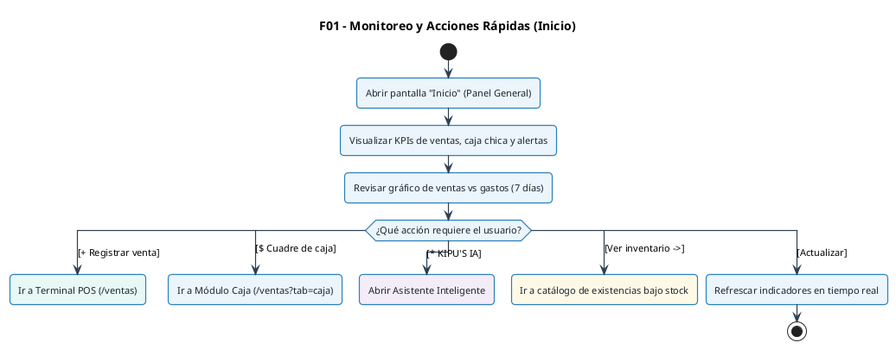

---

### FLUJO 02: Venta en Mostrador (POS)
* **Actores:** Cajero (operador), Dueño / Administrador (supervisor).
* **Pasos Rápidos:**
  1. Clic en `[+ Registrar venta]` desde Inicio o menú lateral.
  2. Pistolear código de barras, escanear con cámara, dictar por voz o buscar producto.
  3. Si hay stock disponible, sumar al carrito; si no, alerta sonora inmediata.
  4. Seleccionar comprobante (`Boleta`, `Factura`, `Nota`) e identificar cliente.
  5. Elegir método de pago (`Efectivo`, `Yape`, `Plin`, `Tarjeta`, `Mixto`) y calcular vuelto.
  6. Clic en `[Cobrar e Imprimir]`: el sistema descuenta stock en Kardex, ingresa dinero a caja, emite ticket e impacta Inicio en tiempo real.

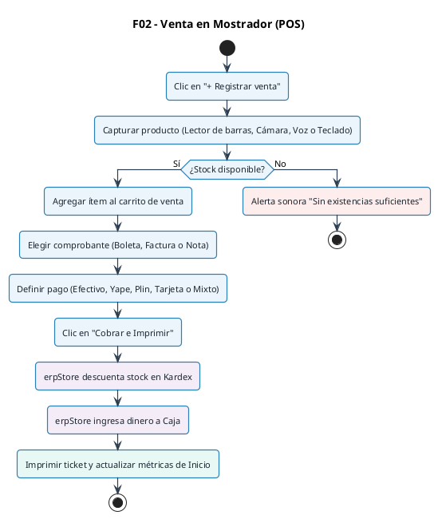

---

### FLUJO 03: Turno y Cuadre de Caja
* **Actores:** Cajero, Dueño / Administrador.
* **Pasos Rápidos:**
  1. Clic en `[$ Cuadre de caja]`. Si la caja está cerrada, ingresar fondo de sencillo y abrir turno.
  2. Cobros de ventas POS y egresos menores se acumulan automáticamente.
  3. Al fin de turno, clic en `[Cerrar Caja]` y digitar el efectivo contado en gaveta.
  4. Comparar contra el saldo esperado: si coincide es `CUADRADA`; si hay diferencia, exige motivo obligatorio.
  5. Cerrar caja y generar reporte de turno.

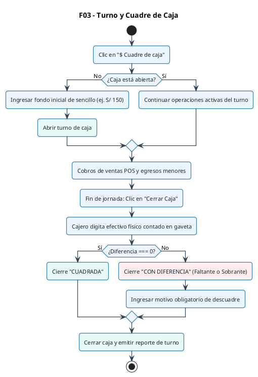

---

### FLUJO 04: Cotizaciones y Devoluciones
* **Actores:** Cajero, Dueño / Administrador.
* **Pasos Rápidos:**
  - **Cotización:** Crear proforma con cliente y productos -> Guardar -> Si el cliente confirma, clic en `[Convertir a Venta]` y pasa directo al POS.
  - **Devolución:** Buscar venta en historial -> Asignar motivo -> Si mercadería está apta, reingresar a stock en Kardex; si se devuelve dinero, asentar egreso en gaveta de caja.

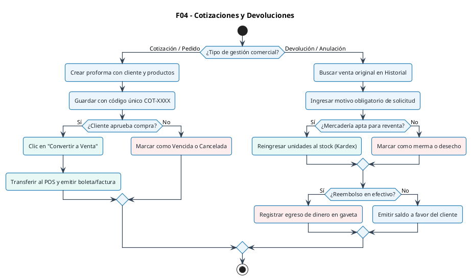

---

### FLUJO 05: Alta de Producto en Inventario
* **Actores:** Almacenero, Dueño / Administrador.
* **Pasos Rápidos:**
  1. Abrir `Inventario` y dar clic en `[Nuevo producto]` o `[Escanear]`.
  2. Pistolear empaque con lector USB o enfocar con cámara del dispositivo.
  3. Si ya existe, carga los datos para editar; si es nuevo, ingresar nombre, categoría y unidad SUNAT.
  4. Ingresar costo y precio de venta (validando que Venta > Costo).
  5. Asignar stock mínimo para alertas y guardar. Si tiene existencias iniciales, asienta Kardex inicial.

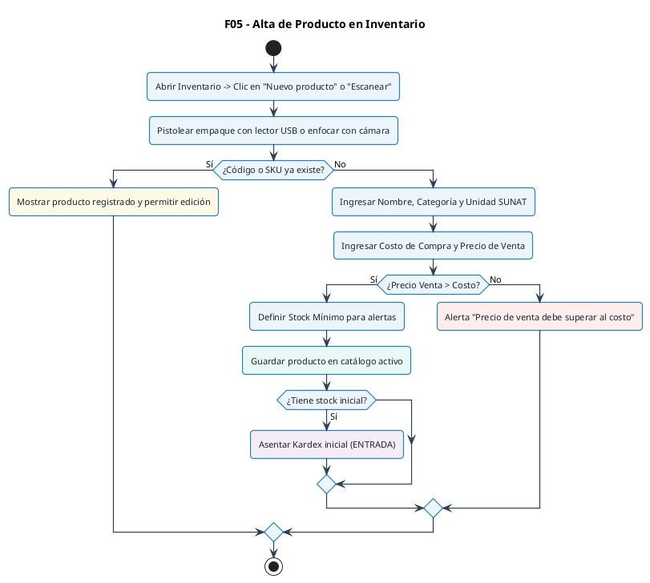

---

### FLUJO 06: Kardex y Alertas de Stock
* **Actores:** Almacenero, Dueño / Administrador.
* **Pasos Rápidos:**
  1. Ocurre una venta, compra, devolución o ajuste.
  2. El sistema calcula el saldo en tiempo real e inserta una fila inmutable en Kardex.
  3. Clasifica el producto: Rojo si está `AGOTADO` (0 unidades), Amarillo si está `BAJO` (<= mínimo), o Verde si está `SUFICIENTE`.
  4. Actualiza inmediatamente las tarjetas de Inicio y alertas de reposición.

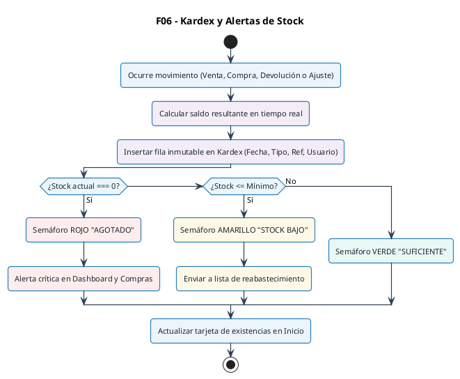

---

### FLUJO 07: Conteo Físico y Ajuste de Mermas
* **Actores:** Almacenero (conteo en estante), Dueño / Administrador (aprobación).
* **Pasos Rápidos:**
  1. Contar unidades físicas reales en el anaquel.
  2. Abrir `Inventario físico` y digitar el stock contado.
  3. Sistema calcula: `Diferencia = Físico - Sistema`.
  4. Si falta mercadería: seleccionar motivo obligatorio (`Rotura`, `Vencimiento`, `Pérdida`). Si sobra: seleccionar motivo de ajuste.
  5. Clic en aplicar: se actualiza el stock real y se genera el Kardex `AUDITORIA_CONTEO`.

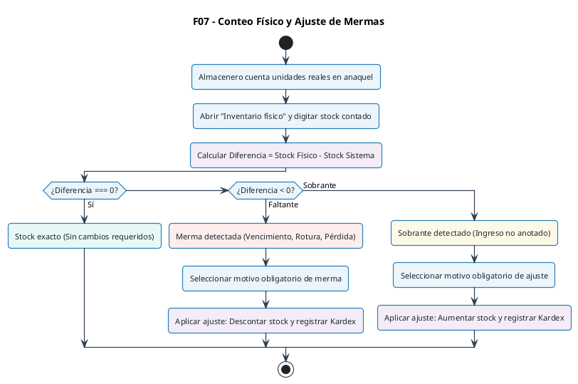

---

### FLUJO 08: Sugerencia de Reabastecimiento
* **Actores:** Dueño / Administrador, Almacenero.
* **Pasos Rápidos:**
  1. Abrir `Compras` -> Clic en `[Sugerencias de Compra]` (o desde la alerta de Inicio).
  2. Motor analiza ventas de los últimos 30 días y productos bajo stock.
  3. Calcula días de cobertura restantes y sugiere cantidad para 30 días de inventario.
  4. Presenta matriz con proveedor sugerido e inversión estimada en soles.
  5. Usuario valida cantidades y genera la Orden de Compra en borrador.

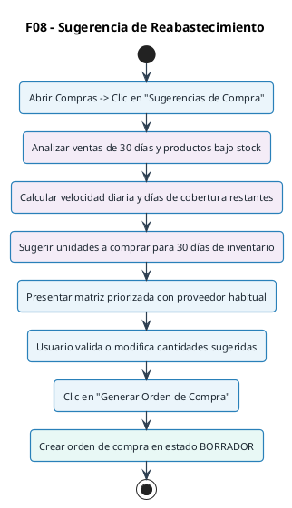

---

### FLUJO 09: Recepción de Mercadería
* **Actores:** Almacenero (recepción física), Dueño / Administrador (control).
* **Pasos Rápidos:**
  1. Llega proveedor con mercadería física y Guía de Remisión o Factura.
  2. Abrir `Compras` -> `[Recepción de mercancía]`.
  3. Digitar número de comprobante, bultos/unidades recibidas y costo unitario real.
  4. Clic en confirmar: aumenta existencias en catálogo, actualiza costo de compra si varió, inserta fila en Kardex (`ENTRADA - COMPRA`) y marca orden como `RECIBIDA`.

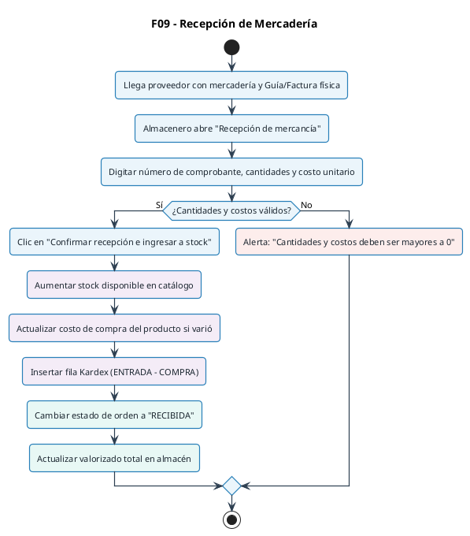

---

### FLUJO 10: Gastos Operativos y Clientes
* **Actores:** Dueño / Administrador (gastos y clientes), Cajero (clientes).
* **Pasos Rápidos:**
  - **Gasto:** Clic en `[Nuevo Gasto]` en `Gastos y clientes` -> Elegir categoría -> Si se paga con dinero de tienda, marca `Afectar caja chica` (resta efectivo de gaveta); si es por banco, no toca la gaveta. Resta de la Utilidad Neta y actualiza el gráfico de Inicio.
  - **Cliente:** Clic en `[Nuevo Cliente]` -> Digitar DNI o RUC con Razón Social -> Queda listo para emisión en POS.

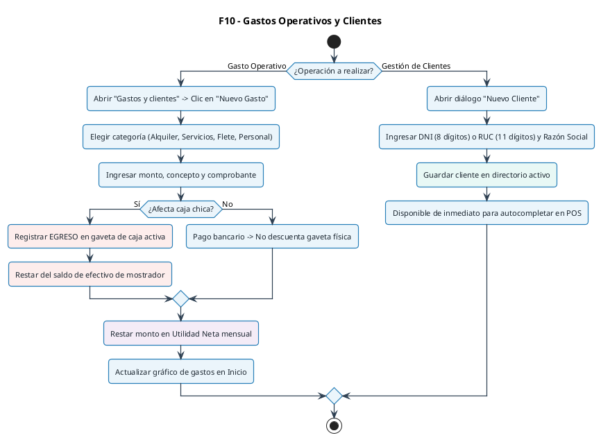

---

### FLUJO 11: Liquidación SUNAT y KIPU'S IA
* **Actores:** Dueño / Administrador (acceso total), Almacenero (solo inventario).
* **Pasos Rápidos:**
  - **Reportes:** Pestaña Financiera (Ventas - Costos = Utilidad Bruta; menos Gastos = Utilidad Neta) | Pestaña SUNAT (IGV Débito vs IGV Crédito) | Exportación a CSV.
  - **KIPU'S IA:** Clic en `[* KIPU'S IA]` desde Inicio -> Dictar por voz o escribir consulta -> La IA analiza estado en tiempo real (caja, facturación, stock crítico) y devuelve diagnóstico con botones de acción directa.

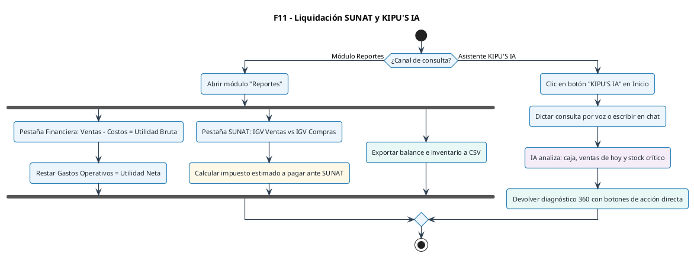
