# KIPU'S ERP — Flujos Operativos Unificados para Servidor UML

Este documento contiene los **flujos operativos reales** de la aplicación **KIPU'S ERP**, estructurados a partir de la interfaz visible (pantalla de Inicio, panel general, botones de acción rápida y menú de navegación). 

Cada flujo está diseñado con **pasos cortos, precisos y cronológicos**, unificando las funciones que comparten los roles (Dueño/Admin, Cajero y Almacenero) para **evitar duplicidades**.

Los diagramas están redactados en **PlantUML (`@startuml ... @enduml`)** y en **Mermaid**, listos para ser procesados y ejecutados en cualquier servidor UML (PlantUML Server, Kroki, Mermaid Live Editor, extensiones de IDE o pipelines CI/CD).

---

## 1. Matriz de Flujos Unificados por Rol

Para no duplicar procesos que realizan múltiples usuarios, los flujos se han consolidado según su ejecución real en la interfaz:

| Flujo | Nombre del Flujo | Roles que lo Usan | Acceso desde la Interfaz |
| :---: | :--- | :--- | :--- |
| **F01** | **Monitoreo Ejecutivo y Panel de Inicio** | Admin, Cajero, Almacén | Menú `Inicio` / Dashboard |
| **F02** | **Venta Completa en Mostrador (POS)** | Cajero, Admin | Botón `[+ Registrar venta]` o `Ventas y caja` |
| **F03** | **Ciclo de Turno y Cuadre de Caja** | Cajero, Admin | Botón `[$ Cuadre de caja]` o link en tarjeta |
| **F04** | **Cotizaciones, Pedidos y Devoluciones** | Cajero, Admin | Pestañas dentro de `Ventas y caja` |
| **F05** | **Alta de Producto con Escáner y Catálogo** | Almacenero, Admin | Menú `Inventario` -> `[Nuevo producto]` / `[Escanear]` |
| **F06** | **Kardex Continuo y Alertas de Stock** | Almacenero, Admin | Menú `Inventario` -> `Entradas y Salidas` / Tarjeta Inicio |
| **F07** | **Conteo Físico y Ajuste de Mermas** | Almacenero, Admin | Menú `Inventario` -> `Inventario físico` / `Ajustes` |
| **F08** | **Reabastecimiento Inteligente de Compras** | Admin, Almacenero | Menú `Compras` -> `[Sugerencias]` o Alerta en Inicio |
| **F09** | **Recepción de Mercadería de Proveedores** | Almacenero, Admin | Menú `Compras` -> `[Recepción de mercancía]` |
| **F10** | **Gastos Operativos y Gestión de Clientes** | Admin (ambos), Cajero (solo clientes) | Menú `Gastos y clientes` (o `Clientes` en cajero) |
| **F11** | **Liquidación SUNAT, Reportes y KIPU'S IA** | Admin (completo), Almacén (solo stock) | Menú `Reportes` o Botón `[* KIPU'S IA]` |

---

## 2. Detalle de Flujos: Pasos Cortos y Diagramas UML

---

### FLUJO 01: Monitoreo Ejecutivo y Panel de Inicio
* **Roles:** Dueño / Administrador (visión 360), Cajero (resumen de ventas/turno), Almacenero (resumen de stock y recepciones).
* **Pasos Cortos y Precisos:**
  1. **Acceso:** El usuario ingresa al sistema y se posiciona en `Inicio`.
  2. **Lectura de KPIs:**
     - Revisa ventas del día y variación porcentual (ej. `S/ 308.60 +12.5%`).
     - Revisa dinero en caja chica y estado del turno (`S/ 640.00` - Caja abierta).
     - Revisa llamadas de atención: productos bajo stock crítico y cobros pendientes.
  3. **Visualización de Tendencia:** Examina la gráfica de barras de ventas vs gastos de los últimos 7 días.
  4. **Disparo de Acción Rápida:**
     - Da clic en `[Actualizar]` para refrescar datos.
     - Da clic en `[$ Cuadre de caja]` para operar gaveta (va a `/ventas?tab=caja`).
     - Da clic en `[+ Registrar venta]` para vender en mostrador (va a `/ventas`).
     - Da clic en `[* KIPU'S IA]` para consultar el estado del negocio por voz o texto.

#### Código UML (PlantUML)
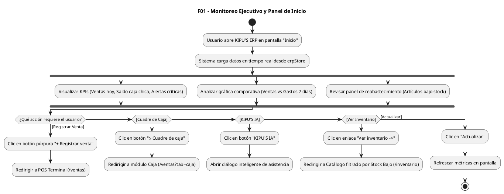

#### Código Mermaid
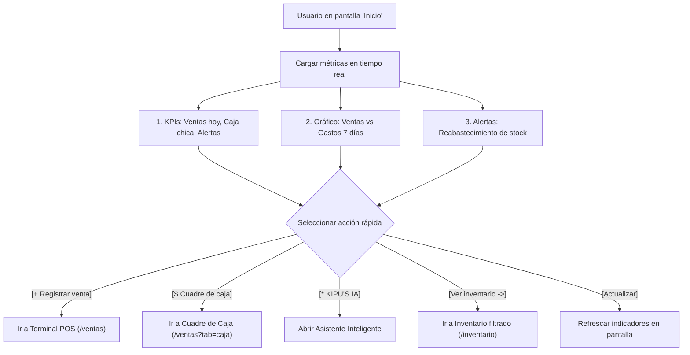

---

### FLUJO 02: Venta Completa en Mostrador (POS)
* **Roles:** Cajero (operador principal), Dueño/Administrador (apoyo/supervisión).
* **Pasos Cortos y Precisos:**
  1. **Disparo:** Clic en `[+ Registrar venta]` desde Inicio o acceso a `Ventas y caja`.
  2. **Ingreso de Producto:** 
     - Pistolear código con lector USB, enfocar con cámara del celular/PC, dictar por voz *"Agrega 2 unidades de arroz"* o buscar por nombre/SKU.
  3. **Validación de Stock:** El sistema valida existencias inmediatas; si hay stock, suma al carrito con su precio unitario.
  4. **Datos de Venta:**
     - Selecciona comprobante: `Boleta`, `Factura` (exige RUC) o `Nota de Venta`.
     - Selecciona o busca cliente (Consumidor final o cliente con DNI/RUC).
  5. **Cobro:** 
     - Elige medio de pago: `Efectivo`, `Yape`, `Plin`, `Tarjeta` o `Mixto`.
     - Ingresa monto entregado por el cliente y el sistema calcula el vuelto exacto.
  6. **Confirmación y Cierre:** Clic en `[Cobrar e Imprimir]`.
  7. **Impacto en el Sistema:**
     - Genera correlativo oficial (ej. `B001-000502`).
     - Descuenta automáticamente el stock en catálogo y genera salida en Kardex.
     - Suma el dinero en la caja activa (efectivo o billetera).
     - Actualiza los KPIs de Inicio (`Ventas de hoy`) al instante.
     - Imprime ticket térmico y limpia la pantalla para la siguiente venta.

#### Código UML (PlantUML)
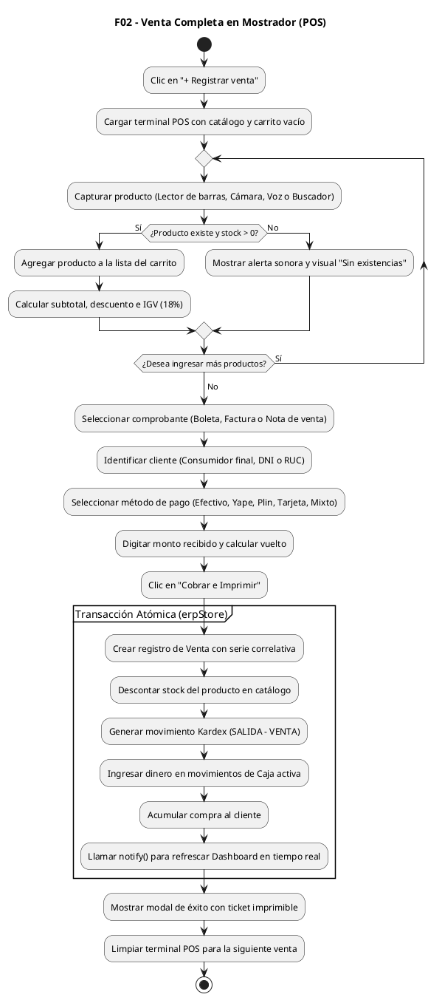

#### Código Mermaid
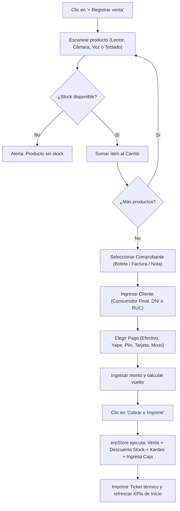

---

### FLUJO 03: Ciclo de Turno y Cuadre de Caja
* **Roles:** Cajero (opera su turno), Dueño/Administrador (audita y controla todas las cajas).
* **Pasos Cortos y Precisos:**
  1. **Apertura:** Clic en `[$ Cuadre de caja]` -> Si la caja está cerrada, se ingresa el monto inicial de sencillo (ej. `S/ 150.00`) y se abre el turno.
  2. **Operación Diaria:** Cada venta en mostrador o egreso manual registrado suma o resta en tiempo real en la gaveta activa.
  3. **Arqueo Físico:** Al auditar o a mitad de turno, se cuentan los billetes y monedas por denominación; el sistema suma el total físico y lo compara contra el teórico.
  4. **Cierre de Turno:**
     - Al terminar el día, el cajero cuenta todo el efectivo en gaveta y digita el monto real contado.
     - El sistema calcula: `Diferencia = Saldo Contado - Saldo Esperado`.
     - Si coincide: estado `CUADRADA`. Si no: estado `CON_DIFERENCIA` (exige justificación obligatoria).
  5. **Finalización:** Se cierra la caja, se genera el reporte de cierre y se bloquean nuevas ventas en esa caja hasta el siguiente turno.

#### Código UML (PlantUML)
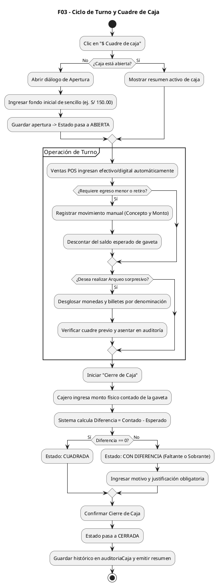

#### Código Mermaid
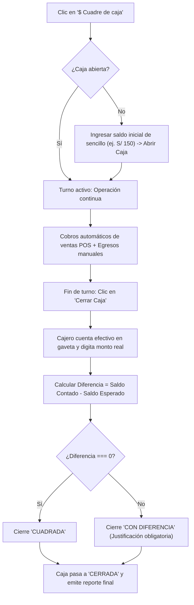

---

### FLUJO 04: Cotizaciones, Pedidos y Devoluciones
* **Roles:** Cajero, Dueño/Administrador.
* **Pasos Cortos y Precisos:**
  1. **Cotización:** Se crea proforma con precios pactados sin tocar stock ni dinero. Si el cliente la aprueba, se da clic en `[Convertir a Venta]` y pasa automáticamente al carrito del POS.
  2. **Devolución / Anulación:** 
     - Se ubica la venta en el historial por su correlativo (ej. `B001-000490`).
     - Se define si el producto regresa en buen estado al almacén (`Retorna a inventario: Sí` suma unidades al stock).
     - Se define si se entrega dinero en efectivo (`Afecta caja: Sí` genera un egreso en la gaveta activa).
     - Se asienta el motivo y se genera el Kardex de ajuste correspondiente.

#### Código UML (PlantUML)
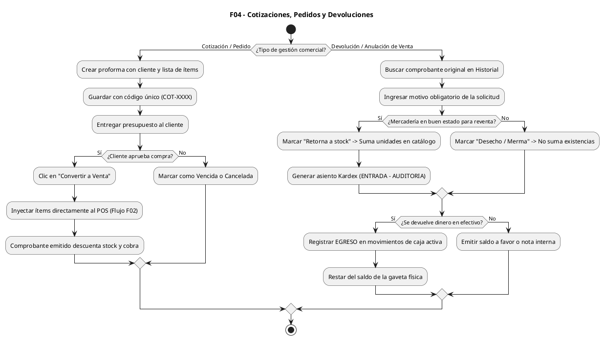

---

### FLUJO 05: Alta de Producto con Escáner y Catálogo
* **Roles:** Almacenero (gestión operativa), Dueño/Administrador (control total y precios).
* **Pasos Cortos y Precisos:**
  1. **Acceso:** Ir a `Inventario` y dar clic en `[Nuevo producto]` o `[Escanear código]`.
  2. **Escaneo de Código:** Pistolear el código del empaque con lector USB o enfocarlo con la cámara.
  3. **Control de Duplicados:** Si el código ya existe, el sistema muestra el producto encontrado y ofrece editarlo.
  4. **Datos Maestros:** Se ingresa Nombre comercial, Categoría, Unidad SUNAT, Precio de Compra (Costo), Precio de Venta (validando que Venta > Costo) y Stock Mínimo de alerta.
  5. **Guardado e Inicialización:** Al guardar, se graba en el catálogo; si tiene existencias iniciales, se crea la fila inicial en Kardex automáticamente.

#### Código UML (PlantUML)
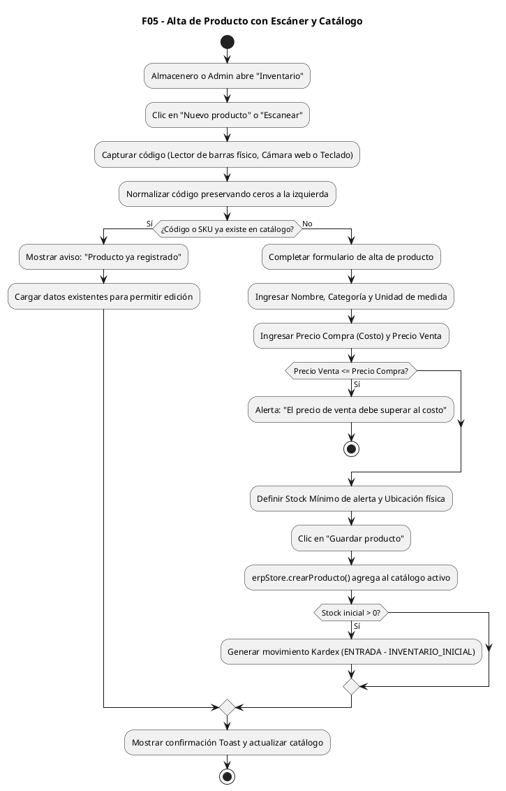

#### Código Mermaid
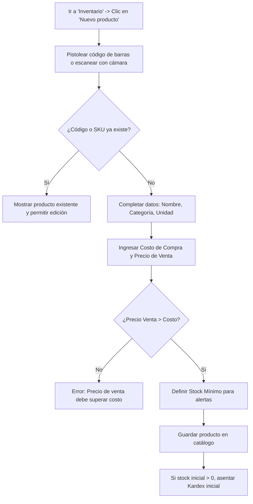

---

### FLUJO 06: Kardex Continuo y Alertas de Stock
* **Roles:** Almacenero, Dueño/Administrador.
* **Pasos Cortos y Precisos:**
  1. **Disparo Transaccional:** Cada venta, compra, devolución o ajuste genera automáticamente una fila en Kardex.
  2. **Registro Inmutable:** Guarda Fecha/Hora, SKU, Producto, Tipo (`ENTRADA`/`SALIDA`/`AJUSTE`), Cantidad, Stock Resultante, Documento de Referencia y Usuario.
  3. **Evaluación de Niveles:** El sistema evalúa el nuevo saldo contra `stockMinimo`:
     - Si `Stock === 0`: Marca en ROJO (`AGOTADO`).
     - Si `Stock <= Mínimo`: Marca en AMARILLO (`STOCK BAJO`).
     - Si `Stock > Mínimo`: Marca en VERDE (`SUFICIENTE`).
  4. **Impacto en Inicio:** Se alimenta la tarjeta `"Atención inmediata"` y `"Alertas de reabastecimiento"` que se ven en la pantalla principal.

#### Código UML (PlantUML)
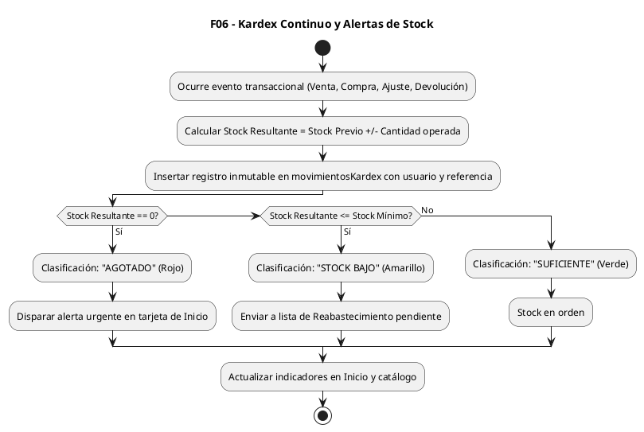

---

### FLUJO 07: Conteo Físico y Ajuste de Mermas
* **Roles:** Almacenero (conteo en estantería), Dueño/Administrador (aprobación de mermas).
* **Pasos Cortos y Precisos:**
  1. **Toma Física:** El almacenero abre `Inventario físico`, cuenta las unidades reales en el estante y digita el valor.
  2. **Cálculo de Variación:** El sistema calcula: `Diferencia = Stock Físico - Stock Sistema`.
  3. **Justificación:** Si hay faltante, selecciona motivo obligatorio (`MERMA`, `VENCIMIENTO`, `ROTURA` o `PÉRDIDA`) con detalle. Si hay sobrante, selecciona `SOBRANTE / INGRESO NO REGISTRADO`.
  4. **Ajuste:** Clic en `[Aplicar ajustes físicos]`. El stock se actualiza al valor real y se asienta el Kardex con motivo `AUDITORIA_CONTEO`.

#### Código UML (PlantUML)
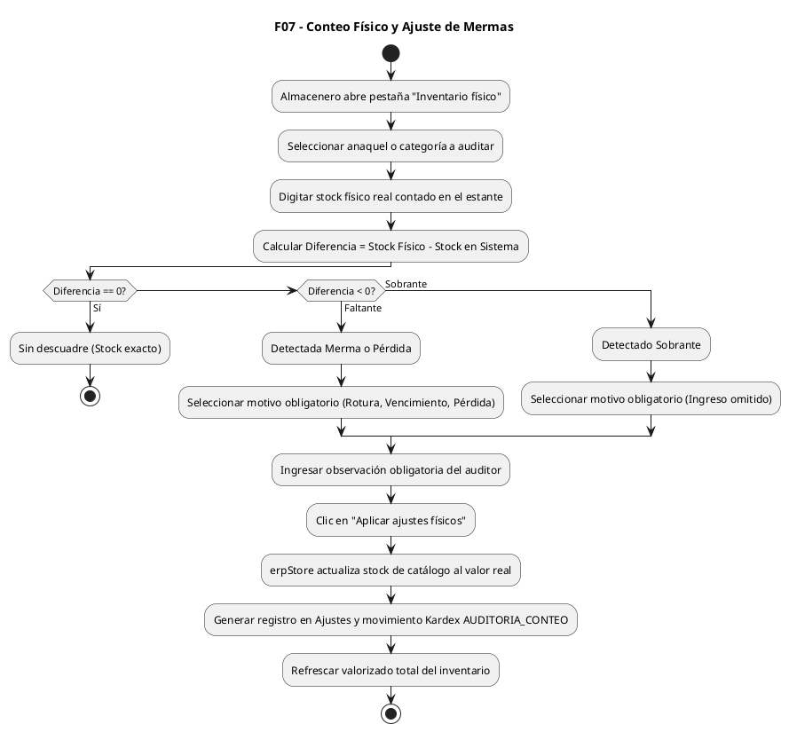

---

### FLUJO 08: Reabastecimiento Inteligente de Compras
* **Roles:** Dueño/Administrador (decisión de compra), Almacenero (consulta y sugerencia).
* **Pasos Cortos y Precisos:**
  1. **Disparo:** Clic en la tarjeta de Inicio `[Alertas de reabastecimiento -> Ver inventario]` o en `Compras -> Sugerencias`.
  2. **Cálculo de Demanda:** El motor analiza las ventas de los últimos 30 días y el stock actual.
  3. **Detección de Quiebre:** Calcula la velocidad diaria de venta y los días de cobertura restantes.
  4. **Recomendación:** Sugiere comprar unidades suficientes para 30 días de cobertura, asignando al proveedor habitual y estimando el monto en soles.
  5. **Generación de Orden:** El usuario selecciona los productos deseados y da clic en `[Generar Orden de Compra]`.

#### Código UML (PlantUML)
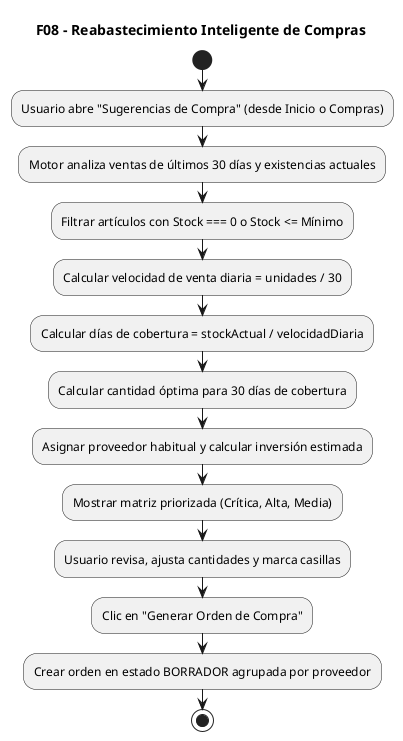

---

### FLUJO 09: Recepción de Mercadería de Proveedores
* **Roles:** Almacenero (recepción física en muelle), Dueño/Administrador (control de facturación).
* **Pasos Cortos y Precisos:**
  1. **Llegada:** El proveedor entrega mercadería con Guía de Remisión o Factura física.
  2. **Apertura:** El almacenero abre `Compras y proveedores` -> `[Recepción de mercancía]`.
  3. **Verificación:** Digita el número de comprobante físico, las cantidades recibidas y el costo de compra unitario.
  4. **Confirmación:** Clic en `[Confirmar recepción e ingresar a stock]`.
  5. **Impacto:** Las existencias aumentan al instante en catálogo, se actualiza el costo de adquisición si varió, se genera la entrada en Kardex (`ENTRADA - COMPRA`) y la orden pasa a `RECIBIDA`.

#### Código UML (PlantUML)
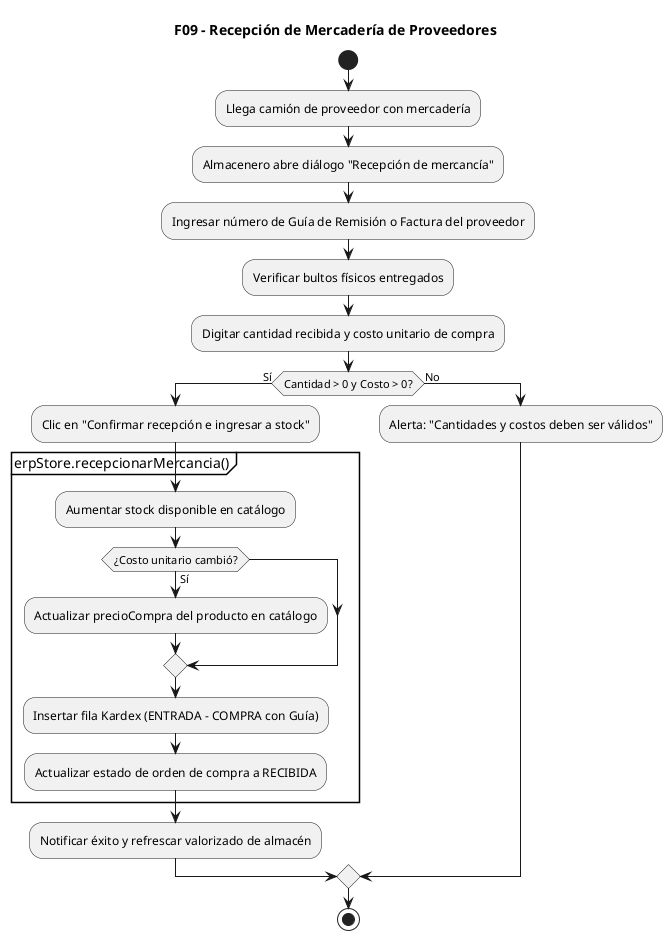

---

### FLUJO 10: Gastos Operativos y Gestión de Clientes
* **Roles:** Dueño/Administrador (gastos y clientes), Cajero (consulta y registro básico de clientes).
* **Pasos Cortos y Precisos:**
  1. **Gastos Operativos (Admin):**
     - Clic en `[Nuevo Gasto]` en `Gastos y clientes`.
     - Elige categoría: Alquiler, Servicios, Flete, Personal, Mantenimiento.
     - Si se paga con dinero de la tienda: marca `Afectar caja chica: Sí` (resta efectivo de la gaveta activa). Si es por transferencia, no toca la gaveta.
     - El gasto resta inmediatamente de la Utilidad Neta en los reportes y en el gráfico de Inicio.
  2. **Clientes (Cajero y Admin):**
     - Registro o consulta con DNI o RUC (con validación de formato).
     - Acumula récord de compras para fidelización y crédito comercial.

#### Código UML (PlantUML)
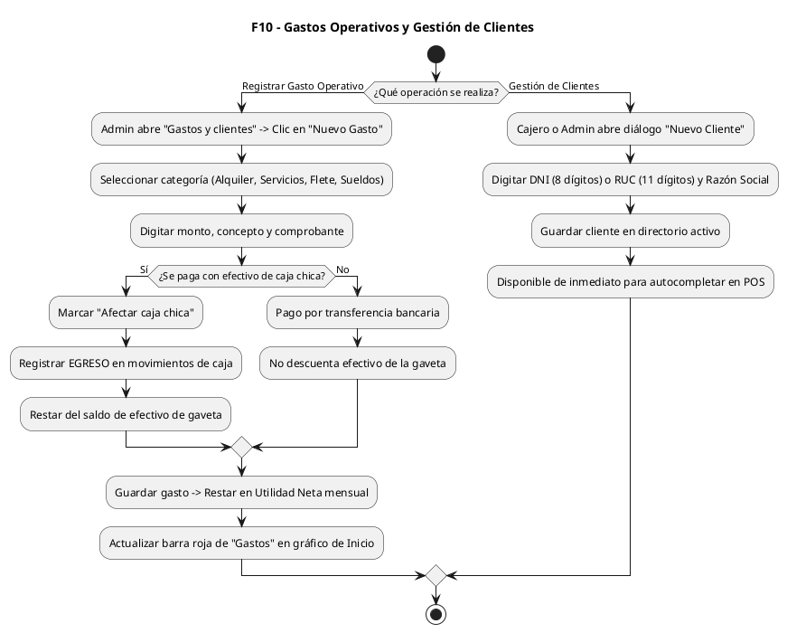

---

### FLUJO 11: Liquidación SUNAT, Reportes y KIPU'S IA
* **Roles:** Dueño/Administrador (acceso completo), Almacenero (solo reporte de inventario valorizado).
* **Pasos Cortos y Precisos:**
  1. **Reportes Financieros:** Calcula en tiempo real:
     $$\text{Ventas Netas} - \text{Costo de Ventas} = \text{Utilidad Bruta}$$
     $$\text{Utilidad Bruta} - \text{Gastos Operativos} = \text{Utilidad Neta}$$
  2. **Liquidación SUNAT:** Cruza IGV cobrado en Boletas/Facturas (Débito) vs IGV pagado en compras con Factura (Crédito fiscal) para estimar el impuesto a pagar.
  3. **KIPU'S IA:** 
     - Clic en botón `[* KIPU'S IA]` desde Inicio o Reportes.
     - Consulta por voz o texto (ej. *"¿Cómo va el negocio hoy?"* o *"¿Tengo stock de arroz?"*).
     - La IA extrae métricas de `erpStore` y responde con tarjetas analíticas y botones de redirección directa a la pantalla con problemas.

#### Código UML (PlantUML)
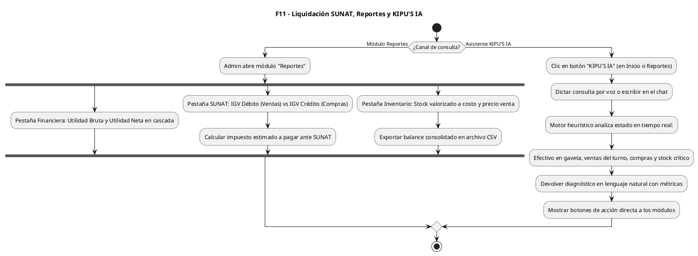

---

## 3. Guía de Ejecución en Servidor UML

Para ejecutar y compilar estos diagramas en cualquier entorno o servidor:

1. **En Servidor PlantUML Oficial o Local:**
   - Copiar el bloque entre `@startuml` y `@enduml` y pegarlo en `http://www.plantuml.com/plantuml` o en tu contenedor Docker local (`docker run -d -p 8080:8080 plantuml/plantuml-server`).
   - También puedes utilizar los archivos individuales `.puml` generados en esta carpeta `docs/UML-flujos/`.

2. **En Mermaid Live Editor / GitHub:**
   - Los bloques de código ````mermaid```` renderizan directamente en GitHub, GitLab, Notion, extensiones de VS Code o en `https://mermaid.live`.

3. **Integración con Herramientas de Modelado:**
   - Compatibles con PlantUML CLI: `plantuml -tpng *.puml` genera las imágenes PNG de todos los flujos de forma automática.

