# KIPU'S ERP — Flujos Operativos Estilo Bizagi BPMN

Este documento consolida los **11 flujos de procesos unificados** de **KIPU'S ERP**, adaptados al estándar visual de diagramas de procesos de negocio **BPMN / Bizagi**:
- **Cajas amplias y legibles** con bordes redondeados y tipografía clara.
- **Acciones cortas, directas y precisas**, basadas en el funcionamiento real de la interfaz.
- **Colores corporativos Bizagi BPMN** (100% compatibles con PlantUML moderno mediante estereotipos y estilos CSS, sin alertas ni advertencias):
  - 🟢 **Verde (`<<verde>>`):** Inicio de proceso, aprobaciones, registros exitosos y emisión de comprobantes.
  - 🔵 **Azul (`<<azul>>`):** Tareas operativas de usuario (navegación, escaneo, digitación).
  - 🟡 **Amarillo (`<<amarillo>>`):** Evaluaciones, decisiones de negocio, alertas preventivas y ajustes.
  - 🟣 **Morado (`<<morado>>`):** Cálculos automáticos del sistema ERP (Kardex, utilidades, asistente IA).
  - 🔴 **Rojo (`<<rojo>>`):** Mermas, alertas críticas de stock agotado y descuadres de caja.
- **Roles unificados:** Los procesos compartidos entre Administrador, Almacenero y Cajero están unificados en un solo flujo maestro para evitar duplicidades.

---

## 1. Matriz de Flujos Unificados por Rol

| N° | Flujo de Proceso | Roles Participantes | Disparador desde la Interfaz | Imagen Generada |
| :---: | :--- | :--- | :--- | :--- |
| **F01** | **Monitoreo y Acciones Rápidas** | Dueño/Admin, Cajero, Almacén | Menú `Inicio` / Dashboard general | `imagenes/01_monitoreo_inicio.png` |
| **F02** | **Venta en Mostrador (POS)** | Cajero, Dueño/Admin | Botón morado `[+ Registrar venta]` o `Ventas y caja` | `imagenes/02_venta_pos_completa.png` |
| **F03** | **Turno y Cuadre de Caja** | Cajero, Dueño/Admin | Botón `[$ Cuadre de caja]` o enlace en tarjeta | `imagenes/03_cuadre_caja_arqueo.png` |
| **F04** | **Cotizaciones y Devoluciones** | Cajero, Dueño/Admin | Pestañas dentro de `Ventas y caja` | `imagenes/04_cotizaciones_devoluciones.png` |
| **F05** | **Alta de Producto en Inventario** | Almacenero, Dueño/Admin | Menú `Inventario` -> `[Nuevo producto]` / `[Escanear]` | `imagenes/05_inventario_escaner_catalogo.png` |
| **F06** | **Kardex y Alertas de Stock** | Almacenero, Dueño/Admin | Menú `Inventario` -> `Entradas y Salidas` / Tarjeta en Inicio | `imagenes/06_kardex_alertas_stock.png` |
| **F07** | **Conteo Físico y Ajuste de Mermas** | Almacenero, Dueño/Admin | Menú `Inventario` -> Pestañas `Ajustes` / `Inventario físico` | `imagenes/07_conteo_fisico_ajustes.png` |
| **F08** | **Sugerencia de Reabastecimiento** | Dueño/Admin | Menú `Compras` -> `[Sugerencias]` o Alerta en Inicio | `imagenes/08_reabastecimiento_compras.png` |
| **F09** | **Recepción de Mercadería** | Almacenero, Dueño/Admin | Menú `Compras` -> `[Recepción de mercancía]` | `imagenes/09_recepcion_mercaderia.png` |
| **F10** | **Gastos Operativos y Clientes** | Dueño/Admin (ambos), Cajero (clientes) | Menú `Gastos y clientes` (o `Clientes` en cajero) | `imagenes/10_gastos_clientes.png` |
| **F11** | **Reportes del Negocio, SUNAT y KIPU'S IA** | Dueño/Admin (completo), Almacén (inventario) | Menú `Reportes` o Botón `[* KIPU'S IA]` en Inicio | `imagenes/11_reportes_sunat_ia.png` |

---

## 2. Diagramas de Proceso (Estilo Bizagi BPMN)

---

### FLUJO 01: Monitoreo y Acciones Rápidas (Inicio)
* **Actores:** Dueño / Administrador, Cajero, Almacenero.
* **Archivo:** [`01_monitoreo_inicio.puml`](file:///d:/ERP-APP/docs/UML-flujos/01_monitoreo_inicio.puml)
* **Imagen:** 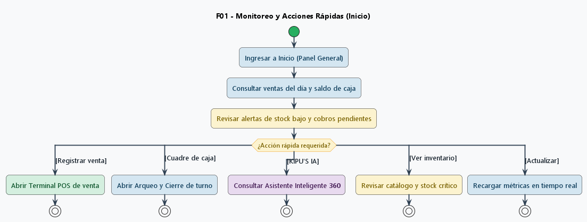

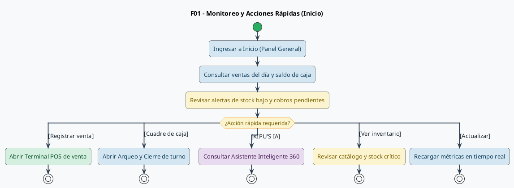

---

### FLUJO 02: Venta en Mostrador (POS)
* **Actores:** Cajero, Dueño / Administrador.
* **Archivo:** [`02_venta_pos_completa.puml`](file:///d:/ERP-APP/docs/UML-flujos/02_venta_pos_completa.puml)
* **Imagen:** 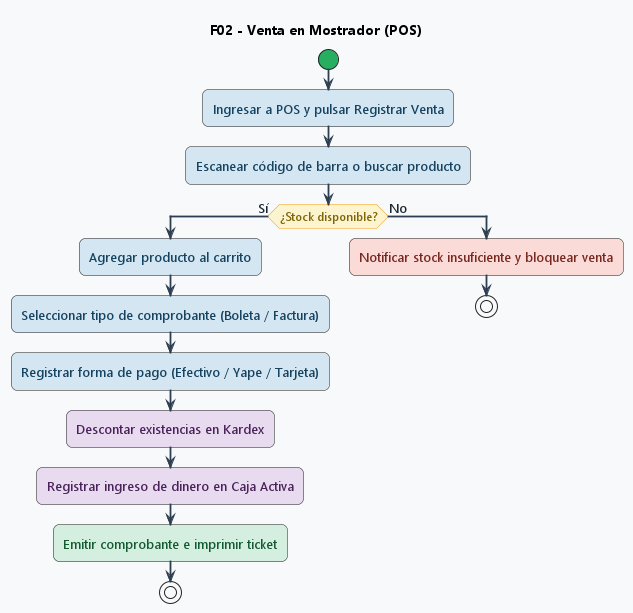

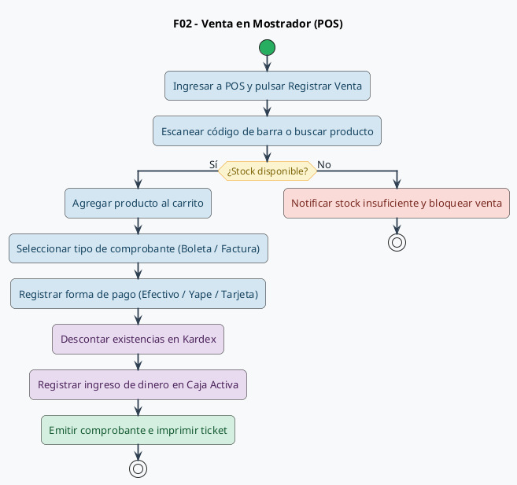

---

### FLUJO 03: Turno y Cuadre de Caja
* **Actores:** Cajero, Dueño / Administrador.
* **Archivo:** [`03_cuadre_caja_arqueo.puml`](file:///d:/ERP-APP/docs/UML-flujos/03_cuadre_caja_arqueo.puml)
* **Imagen:** 

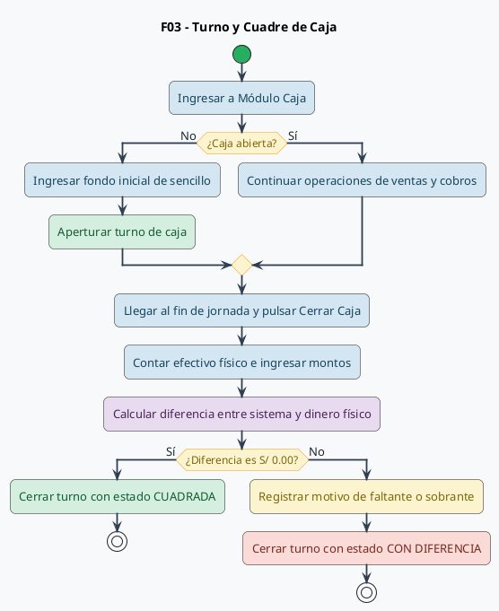

---

### FLUJO 04: Cotizaciones y Devoluciones
* **Actores:** Cajero, Dueño / Administrador.
* **Archivo:** [`04_cotizaciones_devoluciones.puml`](file:///d:/ERP-APP/docs/UML-flujos/04_cotizaciones_devoluciones.puml)
* **Imagen:** 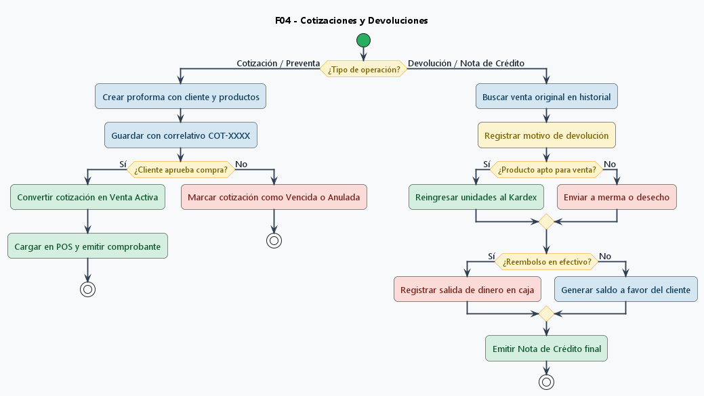

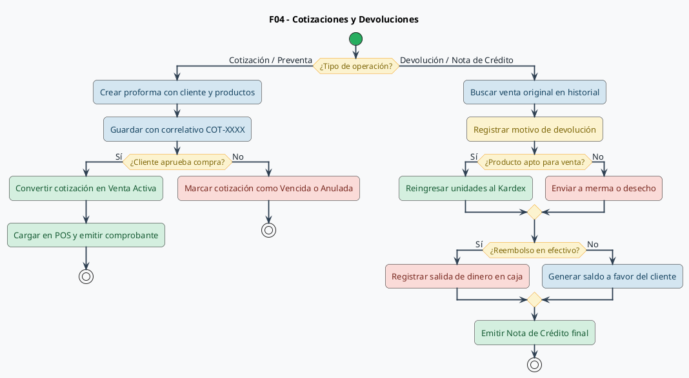

---

### FLUJO 05: Alta de Producto en Inventario
* **Actores:** Almacenero, Dueño / Administrador.
* **Archivo:** [`05_inventario_escaner_catalogo.puml`](file:///d:/ERP-APP/docs/UML-flujos/05_inventario_escaner_catalogo.puml)
* **Imagen:** 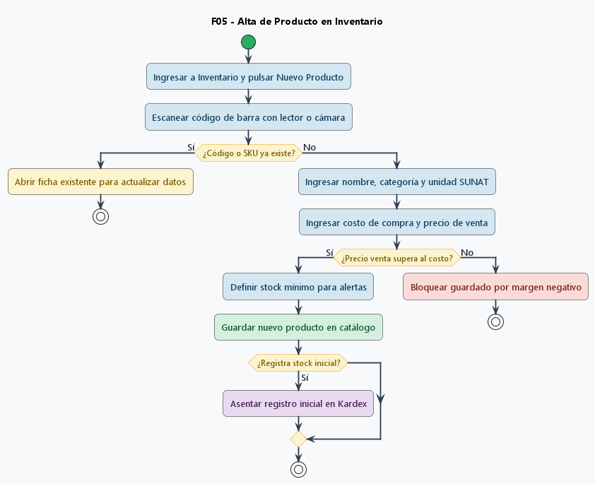

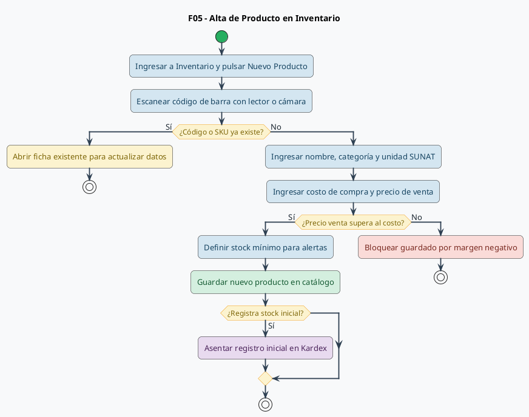

---

### FLUJO 06: Kardex y Alertas de Stock
* **Actores:** Almacenero, Dueño / Administrador.
* **Archivo:** [`06_kardex_alertas_stock.puml`](file:///d:/ERP-APP/docs/UML-flujos/06_kardex_alertas_stock.puml)
* **Imagen:** 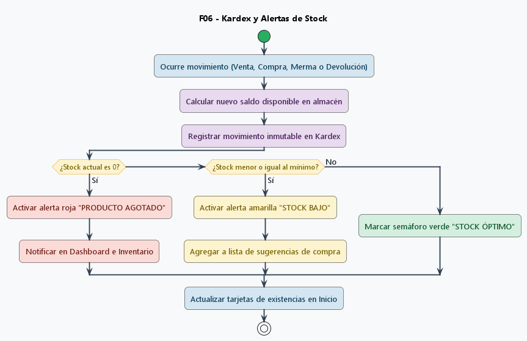

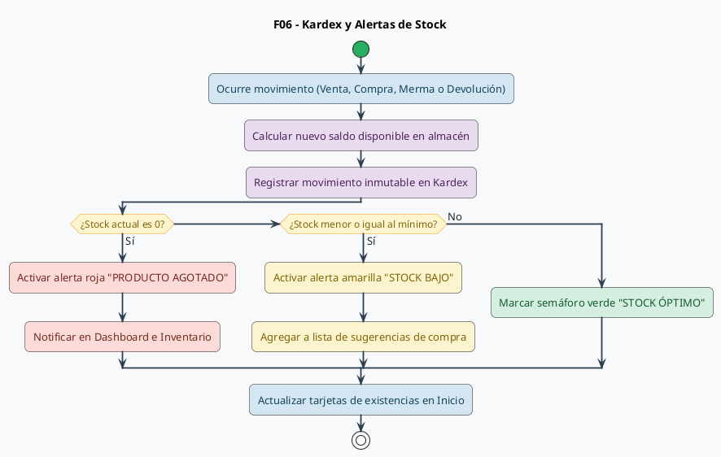

---

### FLUJO 07: Conteo Físico y Ajuste de Mermas
* **Actores:** Almacenero, Dueño / Administrador.
* **Archivo:** [`07_conteo_fisico_ajustes.puml`](file:///d:/ERP-APP/docs/UML-flujos/07_conteo_fisico_ajustes.puml)
* **Imagen:** 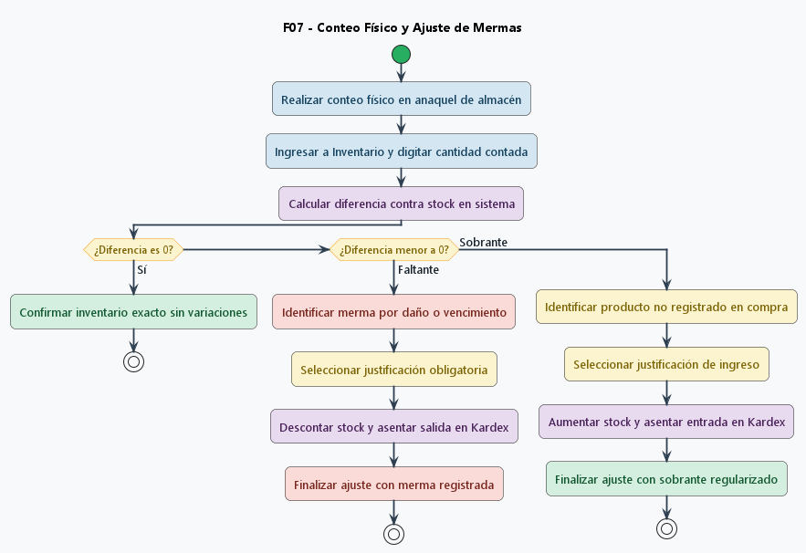

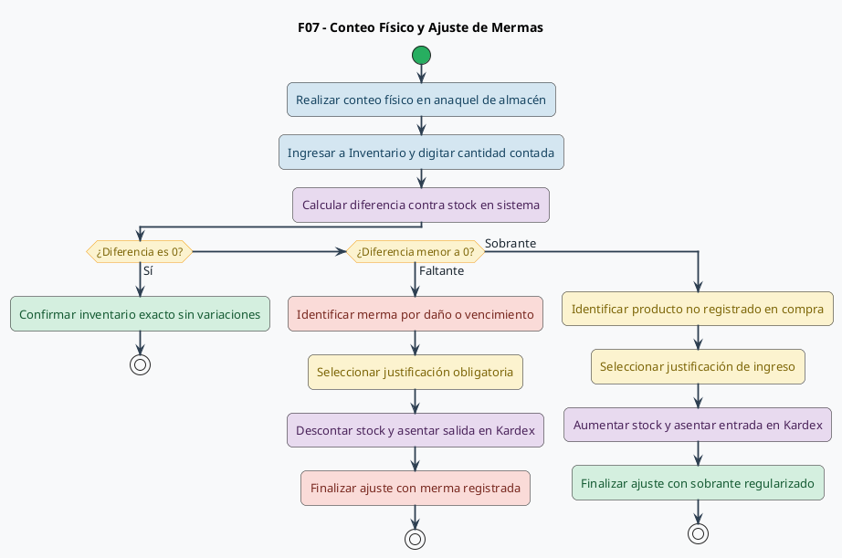

---

### FLUJO 08: Sugerencia de Reabastecimiento
* **Actores:** Dueño / Administrador.
* **Archivo:** [`08_reabastecimiento_compras.puml`](file:///d:/ERP-APP/docs/UML-flujos/08_reabastecimiento_compras.puml)
* **Imagen:** 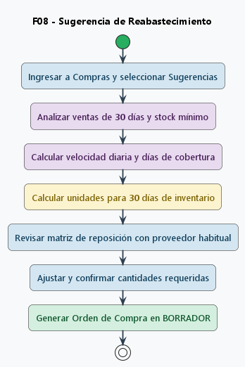

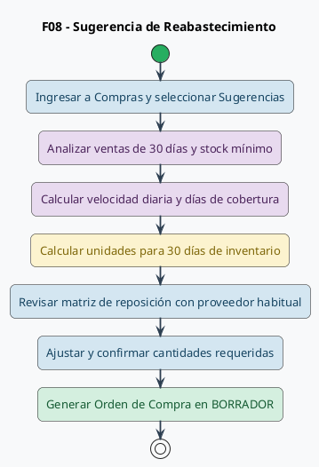

---

### FLUJO 09: Recepción de Mercadería
* **Actores:** Almacenero, Dueño / Administrador.
* **Archivo:** [`09_recepcion_mercaderia.puml`](file:///d:/ERP-APP/docs/UML-flujos/09_recepcion_mercaderia.puml)
* **Imagen:** 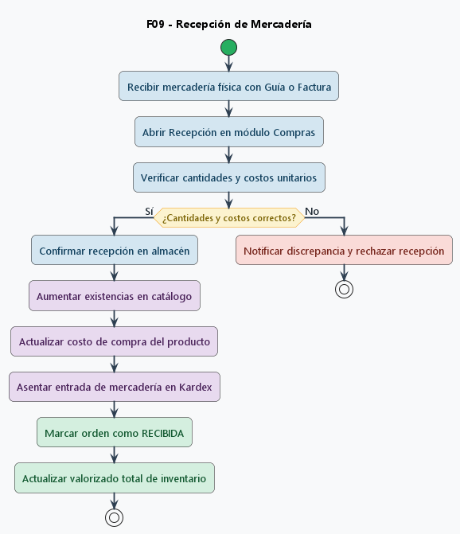

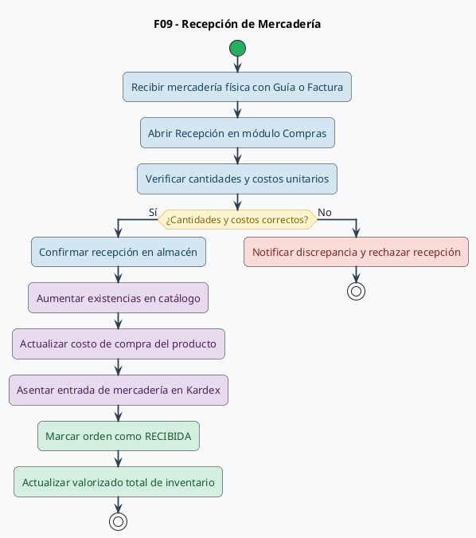

---

### FLUJO 10: Gastos Operativos y Clientes
* **Actores:** Dueño / Administrador (ambos), Cajero (solo clientes).
* **Archivo:** [`10_gastos_clientes.puml`](file:///d:/ERP-APP/docs/UML-flujos/10_gastos_clientes.puml)
* **Imagen:** 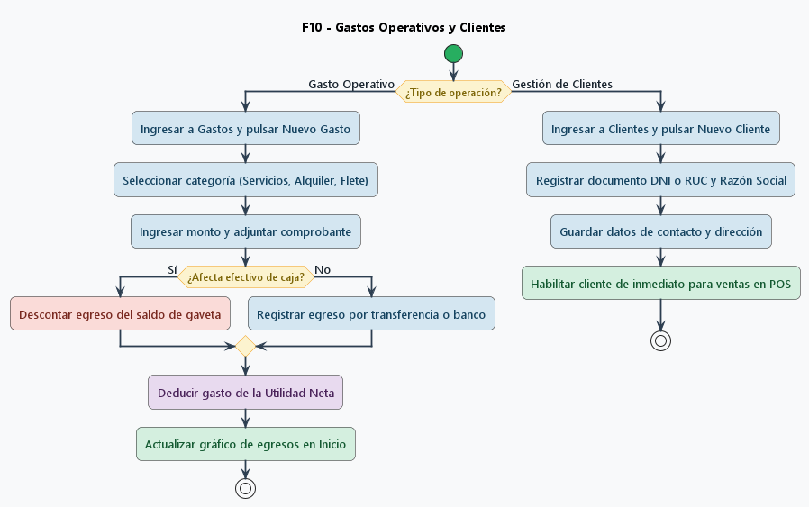

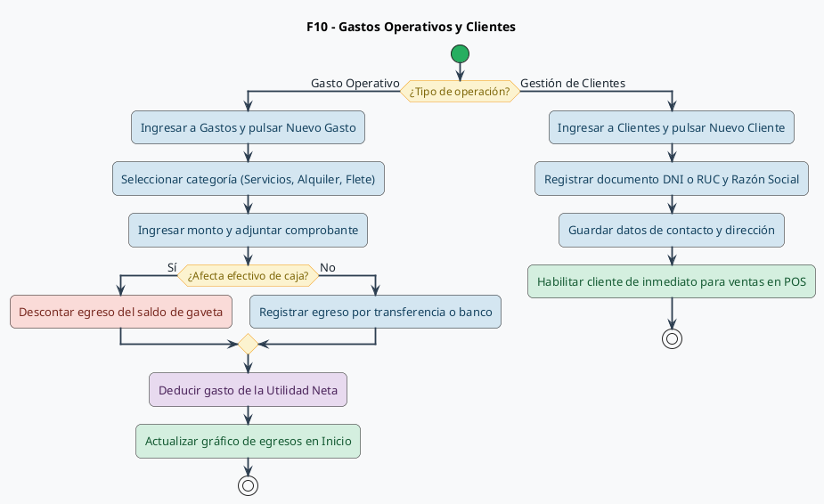

---

### FLUJO 11: Reportes del Negocio, SUNAT y KIPU'S IA
* **Actores:** Dueño / Administrador (completo), Almacenero (reportes de inventario).
* **Archivo:** [`11_reportes_sunat_ia.puml`](file:///d:/ERP-APP/docs/UML-flujos/11_reportes_sunat_ia.puml)
* **Imagen:** 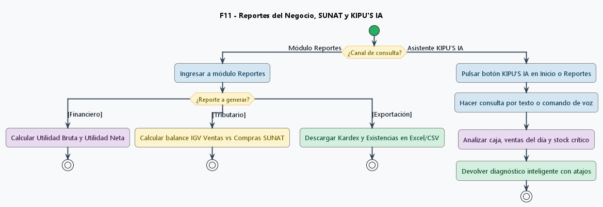

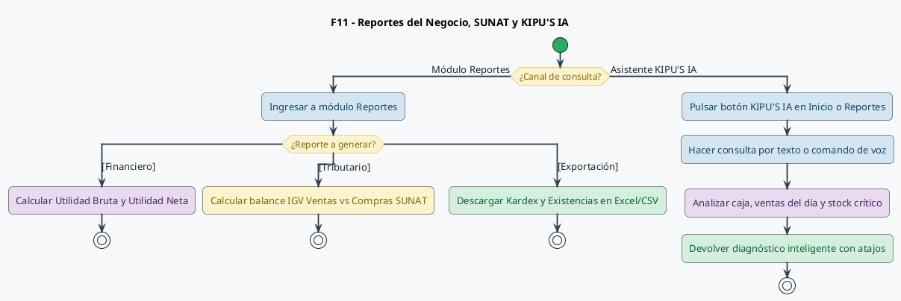

---

## 3. Instrucciones para Word

1. Abre tu documento Word.
2. Ve a la pestaña **Insertar** -> **Imágenes** -> **Este dispositivo...**
3. Navega a la carpeta:
   `D:\ERP-APP\docs\UML-flujos\imagenes\`
4. Selecciona las 11 imágenes generadas (`01_monitoreo_inicio.png` hasta `11_reportes_sunat_ia.png`).
5. Cada imagen cuenta con la resolución óptima, tipografía Segoe UI legible y estilo formal Bizagi BPMN listo para informes ejecutivos y manuales operativos.
