# KIPU'S ERP — Catálogo de Diagramas de Flujo y Matriz de Tareas Operativas

Este documento describe la totalidad de los **diagramas de flujo de procesos** que componen la arquitectura funcional de **KIPU'S ERP**, detallando para cada uno su diagrama visual (en sintaxis Mermaid), su objetivo de negocio, los roles participantes y la **lista exhaustiva de tareas completas paso a paso** (desde el evento disparador hasta el impacto reactivo intermodular y la persistencia en el sistema).

---

## 1. Conteo Global y Clasificación de Flujos

En **KIPU'S ERP** existen **14 diagramas de flujo operativos principales**, organizados en **7 áreas de negocio funcionales**:

| N° | Área Operativa | Nombre del Flujo | Roles Responsables | Estado Técnico |
| :---: | :--- | :--- | :--- | :---: |
| **01** | **Seguridad y Acceso** | Autenticación, Control de Roles (RBAC) y Rutas Protegidas | Admin, Cajero, Almacenero | Implementado |
| **02** | **Seguridad y Acceso** | Detección de Inactividad y Expiración Segura de Sesión (15 min) | Todos los roles | Implementado |
| **03** | **Comercial / Ventas** | Emisión de Venta en POS (Escáner/Voz/Manual) y Cobro Multimedio | Cajero, Admin | Implementado |
| **04** | **Comercial / Ventas** | Cotizaciones y Pedidos con Conversión Directa a Venta | Cajero, Admin | Implementado |
| **05** | **Comercial / Ventas** | Devolución de Mercancía y Anulación de Comprobantes | Admin (Cajero supervisado) | Implementado |
| **06** | **Caja y Tesorería** | Ciclo de Turno de Caja (Apertura, Movimientos y Cierre) | Cajero, Admin | Implementado |
| **07** | **Caja y Tesorería** | Arqueo Físico y Auditoría de Gaveta (Faltantes/Sobrantes) | Admin, Cajero | Implementado |
| **08** | **Inventario y Almacén** | Alta y Edición de Productos con Escáner de Barras / Cámara | Almacenero, Admin | Implementado |
| **09** | **Inventario y Almacén** | Trazabilidad Continua de Kardex y Semáforo de Reposición | Almacenero, Admin | Implementado |
| **10** | **Inventario y Almacén** | Auditoría de Conteo Físico y Ajuste de Inventario (Mermas) | Almacenero, Admin | Implementado |
| **11** | **Compras y Abastecimiento** | Sugerencia Inteligente de Reabastecimiento por Demanda | Admin, Almacenero | Implementado |
| **12** | **Compras y Abastecimiento** | Emisión de Órdenes y Recepción de Mercadería de Proveedores | Almacenero, Admin | Implementado |
| **13** | **Gastos y Clientes** | Registro de Gastos Operativos y Gestión de Clientes | Admin, Cajero | Implementado |
| **14** | **Inteligencia y Cierre** | Liquidación Tributaria SUNAT, Balances y Diagnóstico IA | Admin | Implementado |

---

## 2. Mapa de Interconexión Reactiva en Tiempo Real

Todos los flujos transaccionales del ERP se comunican a través del bus reactivo en memoria y almacenamiento local (`erpStore.ts`). El siguiente diagrama resume cómo interactúan los flujos entre sí:

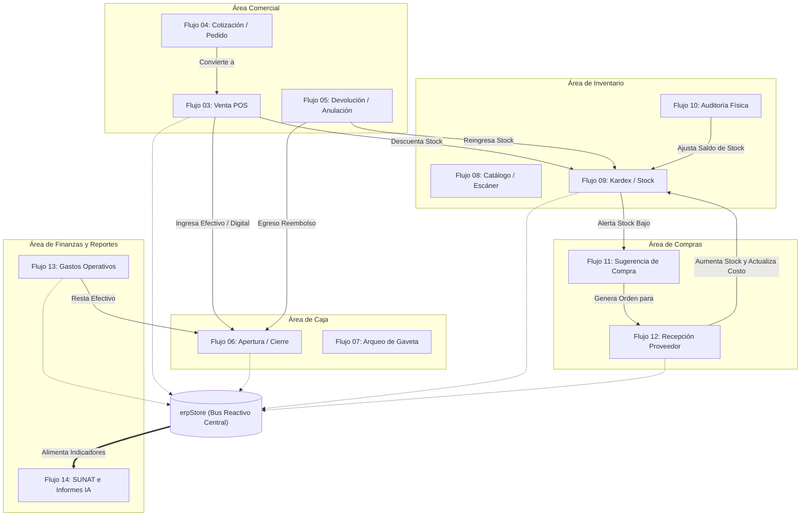

---

## 3. Detalle Exhaustivo de los 14 Flujos y Tareas Operativas

---

### FLUJO 01: Autenticación, Control de Roles (RBAC) y Rutas Protegidas

#### A. Diagrama de Flujo
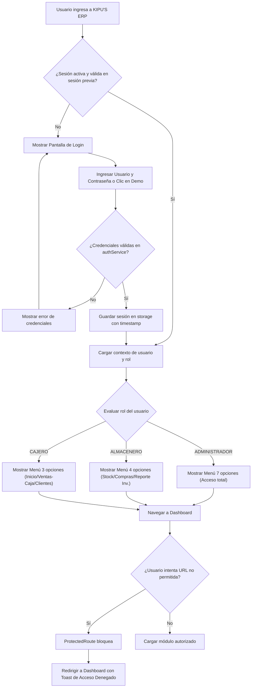

#### B. Tareas Completas del Flujo
- **T01.1 (Precondición):** Sistema verifica en `sessionStore` si existe un token de sesión y una marca temporal (`lastActivity`) no expirada.
- **T01.2 (Entrada):** Si no hay sesión válida, se despliega la pantalla de login con selector de credenciales o botón de acceso rápido para demostración (`admin`, `caja`, `almacen`).
- **T01.3 (Validación):** `authService.login()` contrasta credenciales contra el catálogo seguro de usuarios autorizados.
- **T01.4 (Almacenamiento):** Al ser exitoso, se graba la sesión en `localStorage` o `sessionStorage` guardando `token`, `usuario`, `rol` y `sucursal`.
- **T01.5 (Construcción de Navegación):** `getNavigationItemsForRole(rol)` genera la barra lateral con exactamente los módulos asignados por perfil (Admin: 7, Almacenero: 4, Cajero: 3).
- **T01.6 (Guardia Activa):** `ProtectedRoute` intercepta cada navegación; si el rol no tiene permisos según `canAccessRoute(path, rol)`, cancela la carga, redirige a `/dashboard` y emite una alerta toast.

---

### FLUJO 02: Detección de Inactividad y Expiración Segura de Sesión

#### A. Diagrama de Flujo
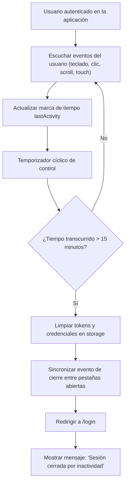

#### B. Tareas Completas del Flujo
- **T02.1 (Monitoreo):** `AuthContext` activa listeners pasivos (`mousemove`, `keydown`, `click`, `scroll`, `touchstart`) con limitador de frecuencia (*throttle*).
- **T02.2 (Registro):** Cada interacción válida actualiza la marca temporal en `sessionStore.updateLastActivity()`.
- **T02.3 (Verificación en Re-enfoque):** Al volver el foco a la ventana o despertar el equipo de suspensión (`visibilitychange` / `focus`), se calcula la diferencia contra la hora actual.
- **T02.4 (Disparo de Expiración):** Si el delta supera 900,000 ms (15 minutos), se elimina la sesión activa.
- **T02.5 (Sincronización Multiventana):** Se emite un evento de almacenamiento para que las demás pestañas cierren sesión simultáneamente.
- **T02.6 (Cierre Seguro):** Redirección inmediata a `/login` presentando un banner informativo sin revelar datos previos del negocio.

---

### FLUJO 03: Emisión de Venta en POS y Facturación Multimedio

#### A. Diagrama de Flujo
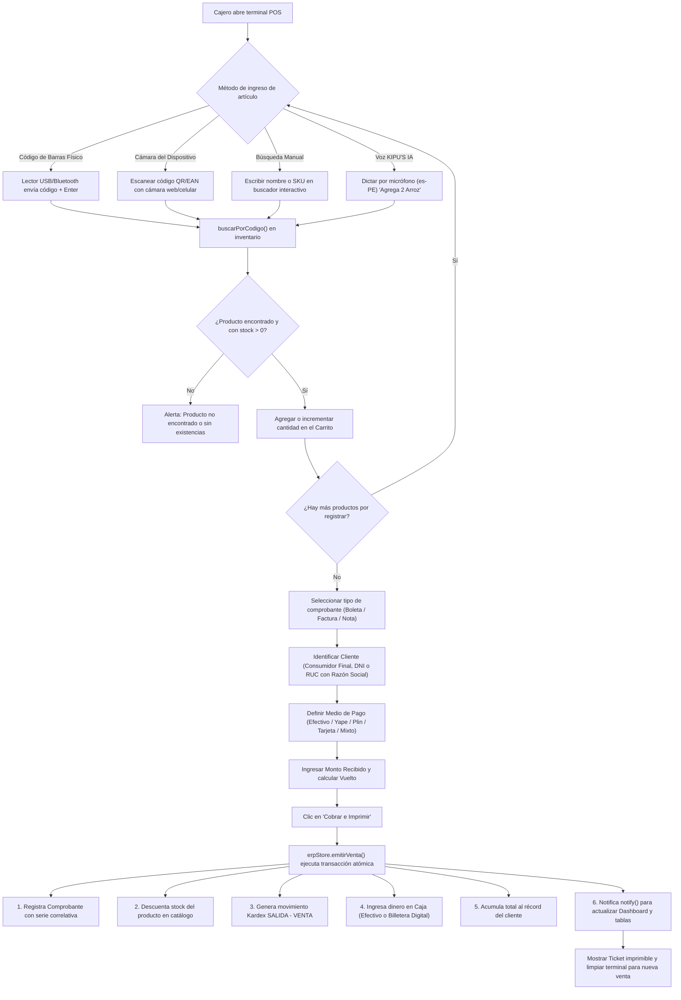

#### B. Tareas Completas del Flujo
- **T03.1 (Apertura de Turno):** Validar que la caja receptora esté en estado `ABIERTA`; si está cerrada, sugerir apertura.
- **T03.2 (Captura de Ítems):**
  - Vía escáner de hardware: captura directa en input sin perder ceros a la izquierda.
  - Vía cámara: activación de sensor de video con ZXing, lectura de un solo disparo y liberación inmediata del lente.
  - Vía voz: transcripción fonética y extracción de cantidad + sustantivo.
- **T03.3 (Validación de Existencias):** Validación contra `prod.stock`; impide agregar cantidades mayores a las disponibles en estante.
- **T03.4 (Cálculos Tributarios):** Determinación automática de Subtotal (base imponible), IGV (18%) y Total. Si es Nota de Venta no desglosa IGV.
- **T03.5 (Liquidación de Pago):** Cálculo del vuelto exacto en efectivo o desglose mixto (ej. S/ 20 en efectivo + S/ 15 en Yape).
- **T03.6 (Transacción Atómica en erpStore):**
  - Generación de serie correlativa (`B001-XXXXXX`, `F001-XXXXXX`, `NV01-XXXXXX`).
  - Descuento de stock en `productos`.
  - Creación de registro inmutable en `movimientosKardex`.
  - Registro de movimiento en `movimientosCaja` y actualización de saldo en gaveta.
  - Acumulación de compras en el cliente.
- **T03.7 (Finalización):** Disparo de `notify()`, refresco reactivo de todos los componentes y presentación del modal de éxito para impresión térmica.

---

### FLUJO 04: Cotizaciones y Pedidos con Conversión a Venta

#### A. Diagrama de Flujo
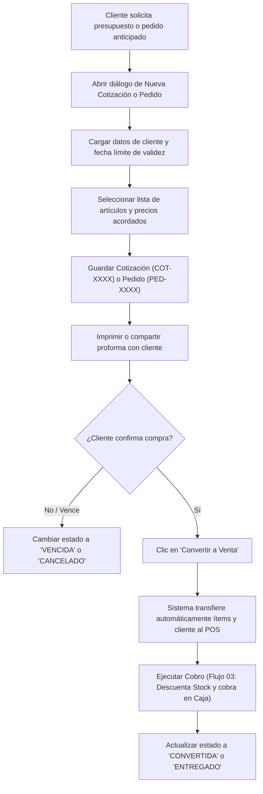

#### B. Tareas Completas del Flujo
- **T04.1 (Generación):** Creación de proforma comercial sin descontar stock físico ni ingresar dinero a caja.
- **T04.2 (Seguimiento):** Monitoreo del estado (`PENDIENTE`, `APROBADO`, `RECHAZADO`, `VENCIDO`).
- **T04.3 (Disparador de Conversión):** Ejecución de `convertirCotizacionAVenta()` o `convertirPedidoAVenta()`.
- **T04.4 (Transformación):** Inyección de los ítems en el módulo de facturación con el tipo de comprobante adecuado (Factura si tiene RUC, Boleta si tiene DNI).
- **T04.5 (Cierre):** El comprobante emitido queda vinculado a la cotización original para trazabilidad comercial.

---

### FLUJO 05: Devolución de Mercancía y Anulación de Comprobantes

#### A. Diagrama de Flujo
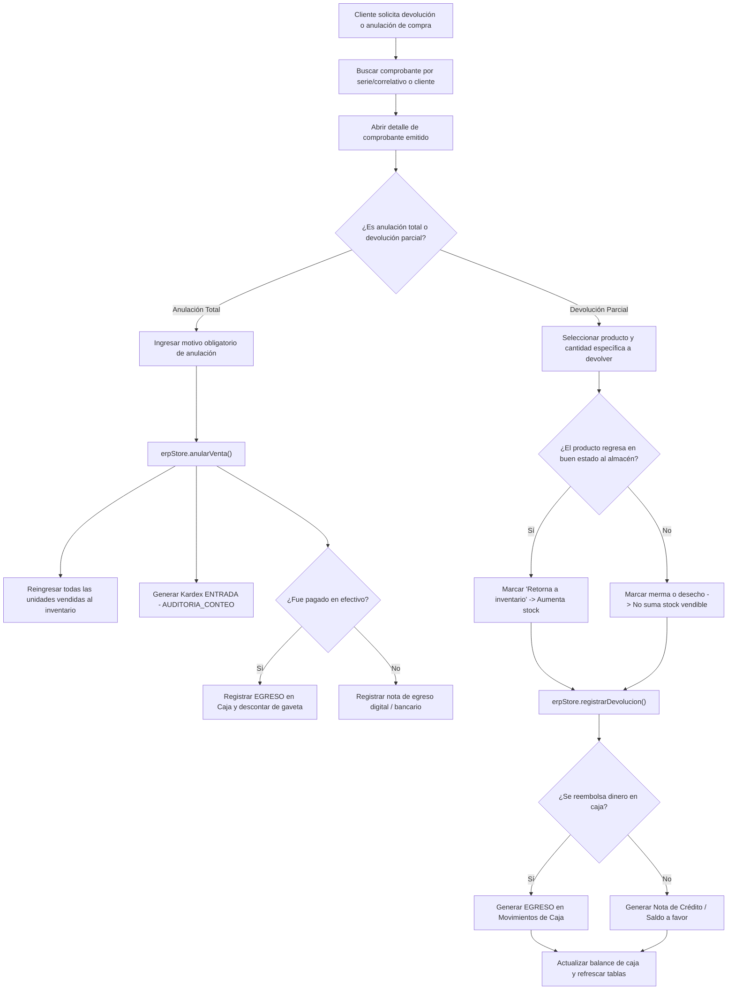

#### B. Tareas Completas del Flujo
- **T05.1 (Localización):** Ubicación del ticket en el historial de ventas mediante búsqueda rápida por código.
- **T05.2 (Clasificación):** Distinguir entre cancelación de factura errónea (anulación total) o cambio de producto defectuoso/equivocado (devolución de ítem).
- **T05.3 (Decisión de Stock):** Determinar si el producto devuelto se reincorpora al catálogo vendible o se envía a cuarentena/merma.
- **T05.4 (Afectación Contable de Caja):** Si el pago fue en efectivo y se devuelve el importe, se asienta una salida formal en la gaveta con concepto `"Reembolso por devolución B001-XXXX"`.
- **T05.5 (Trazabilidad en Kardex):** Registro del reingreso con referencia al comprobante y usuario responsable.

---

### FLUJO 06: Ciclo de Turno de Caja (Apertura, Operación y Cierre)

#### A. Diagrama de Flujo
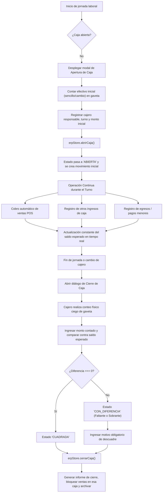

#### B. Tareas Completas del Flujo
- **T06.1 (Apertura Formal):** Registro del fondo fijo para dar vuelto (ej. S/ 150.00 en monedas y billetes pequeños).
- **T06.2 (Acumulación Multicanal):** La caja clasifica en cubetas independientes el dinero físico en efectivo de los cobros digitales (Yape, Plin, POS Visa, Transferencias BCP/BBVA).
- **T06.3 (Operaciones Manuales):** Posibilidad de registrar retiros de caja chica para compras de emergencia o ingresos extraordinarios.
- **T06.4 (Conteo Ciego de Cierre):** El cajero ingresa lo que contó físicamente antes de ver el número teórico del sistema para evitar sesgos.
- **T06.5 (Determinación de Brechas):** Cálculo automático de `Diferencia = Contado - Esperado`.
- **T06.6 (Bloqueo y Reporte):** La caja pasa a estado `CERRADA`, se emite el ticket de cierre con el total de operaciones y se actualiza el histórico de auditoría.

---

### FLUJO 07: Arqueo Físico y Auditoría de Gaveta

#### A. Diagrama de Flujo
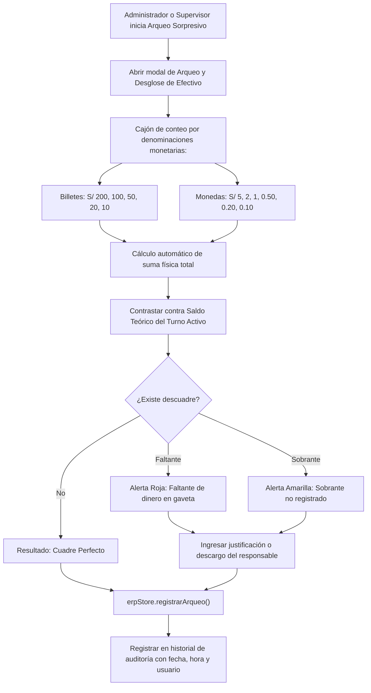

#### B. Tareas Completas del Flujo
- **T07.1 (Disparador de Control):** Inspección inopinada o de mitad de turno.
- **T07.2 (Conteo Desglosado):** Matriz de denominaciones peruanas para evitar errores de conteo a mano.
- **T07.3 (Cálculo Inmediato):** Multiplicación de unidades por valor facial y suma consolidada.
- **T07.4 (Justificación):** Si hay discrepancia, se exige registrar el motivo (ej. *"Pago de flete no anotado"*, *"Error en vuelto a cliente"*).
- **T07.5 (Asiento de Auditoría):** Se guarda un registro indeleble en `auditoriaCaja` que no puede ser alterado ni eliminado.

---

### FLUJO 08: Alta y Edición de Productos con Escáner de Barras / Cámara

#### A. Diagrama de Flujo
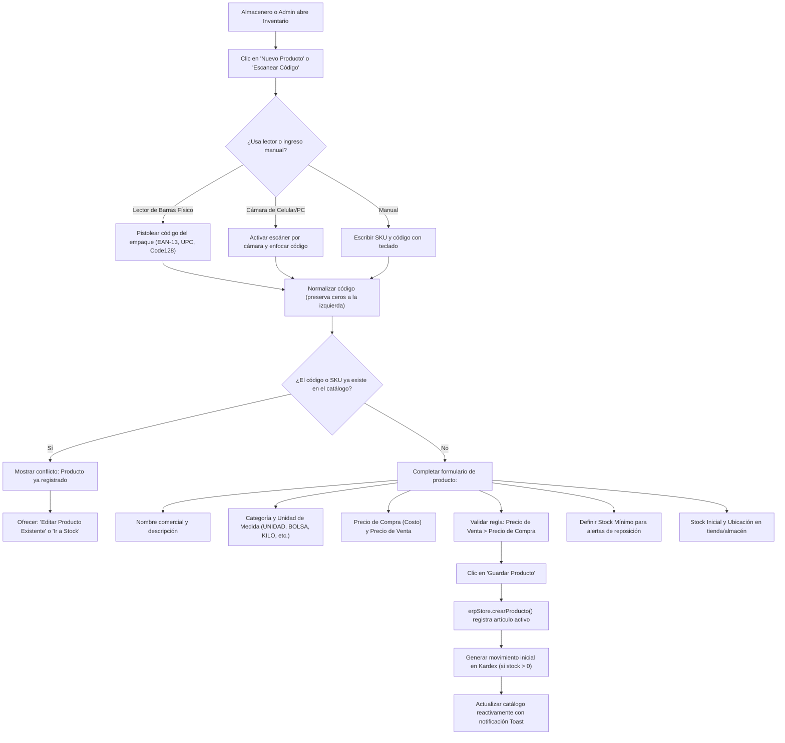

#### B. Tareas Completas del Flujo
- **T08.1 (Detección de Identificadores):** Captura del código de barras comercial y generación del SKU interno.
- **T08.2 (Validación de Duplicados):** `validarCodigoUnico()` asegura que ningún producto comparta código de barras ni SKU con otro.
- **T08.3 (Control Financiero de Márgenes):** Verificación de rentabilidad; alerta si el precio de venta es inferior o igual al costo de adquisición.
- **T08.4 (Definición de Políticas de Reposición):** Ajuste de umbral de stock mínimo (`stockMinimo`) para que el sistema aprenda cuándo alertar.
- **T08.5 (Inicialización en Kardex):** Si el producto ingresa con existencias iniciales, se crea automáticamente un registro `ENTRADA` con motivo `INVENTARIO_INICIAL`.

---

### FLUJO 09: Trazabilidad Continua de Kardex y Semáforo de Reposición

#### A. Diagrama de Flujo
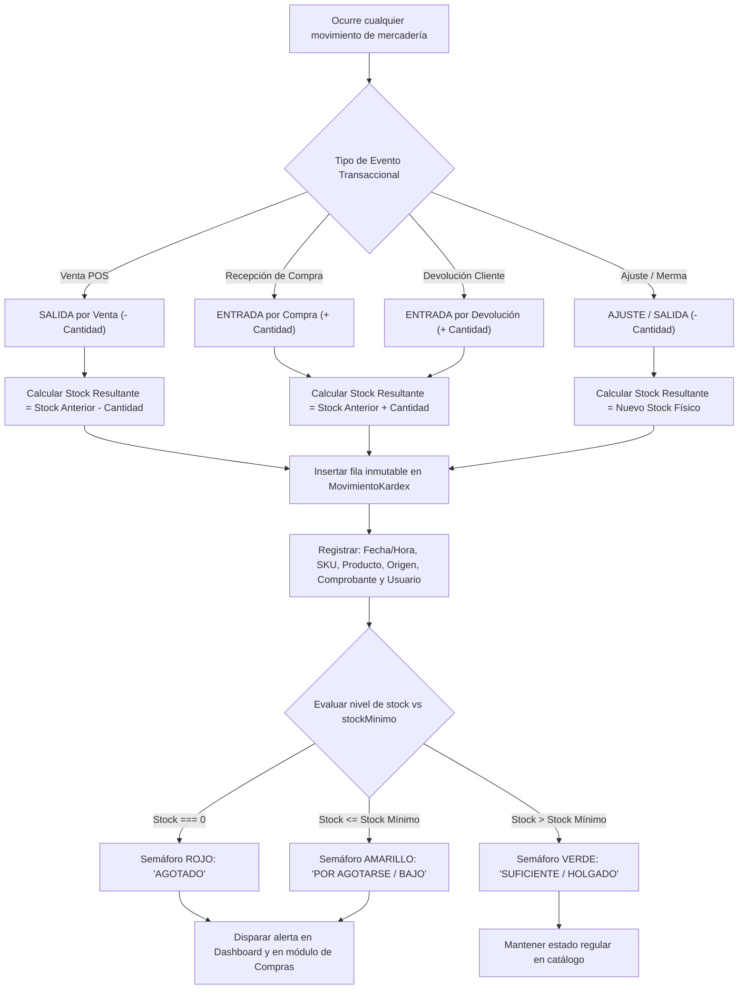

#### B. Tareas Completas del Flujo
- **T09.1 (Principio de Inmutabilidad):** Todo cambio en existencias debe estar respaldado por un registro histórico con responsable y documento.
- **T09.2 (Cálculo de Saldo Correlativo):** Cada línea de Kardex refleja el saldo exacto que quedó en ese segundo en el almacén.
- **T09.3 (Evaluación Continua de Niveles):** Función reactiva que reclasifica el estado del producto (`SUFICIENTE`, `STOCK_BAJO`, `AGOTADO`).
- **T09.4 (Emisión de Alertas Operativas):** Comunicación automática hacia las tarjetas de inicio y la campana de alertas del Almacenero y Administrador.

---

### FLUJO 10: Auditoría de Conteo Físico y Ajuste de Inventario

#### A. Diagrama de Flujo
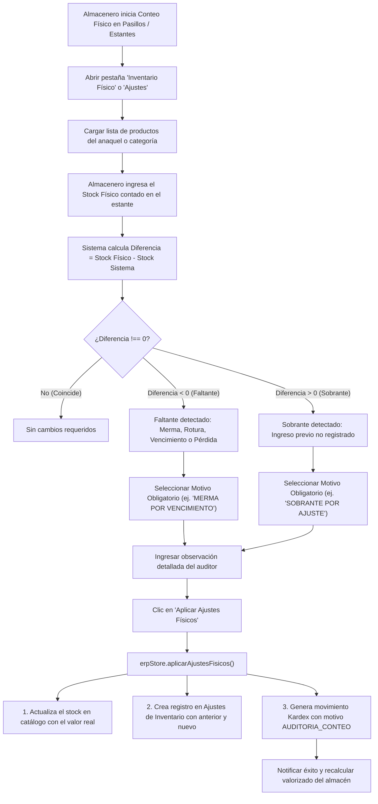

#### B. Tareas Completas del Flujo
- **T10.1 (Planificación de Conteo):** Selección de estantería o muestreo rotativo.
- **T10.2 (Captura de Datos Físicos):** Registro de unidades palpables sin alterar inmediatamente el catálogo.
- **T10.3 (Análisis de Variaciones):** El sistema calcula las diferencias numéricas y monetarias de cada descuadre.
- **T10.4 (Exigencia de Justificación):** Regla de negocio: ningún ajuste puede guardarse sin un motivo explícito de la lista reglamentada.
- **T10.5 (Alineamiento Contable):** Ajuste definitivo del saldo en el catálogo y creación del registro de auditoría.

---

### FLUJO 11: Sugerencia Inteligente de Reabastecimiento por Demanda

#### A. Diagrama de Flujo
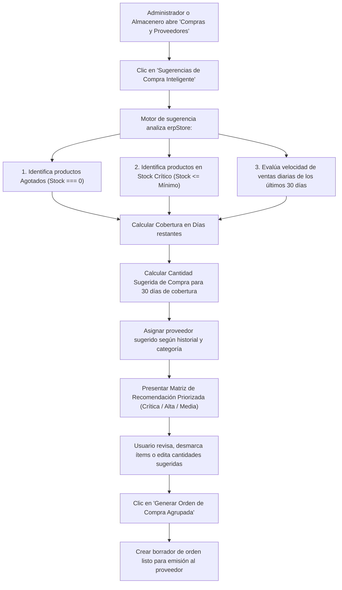

#### B. Tareas Completas del Flujo
- **T11.1 (Recopilación de Demanda):** Extracción de ventas históricas excluyendo comprobantes anulados.
- **T11.2 (Cálculo de Velocidad de Consumo):** Determinación de unidades consumidas por día (`unidadesVendidas / 30`).
- **T11.3 (Detección de Días de Cobertura):** `diasCobertura = stockActual / velocidadVentaDiaria`.
- **T11.4 (Asignación Automática de Proveedor):** Búsqueda del distribuidor que suministra la categoría correspondiente.
- **T11.5 (Proyección Financiera):** Cálculo de inversión estimada multiplicando cantidad sugerida por el último precio de compra.
- **T11.6 (Conversión a Orden):** Agrupación en una o varias órdenes de compra en borrador.

---

### FLUJO 12: Emisión de Órdenes y Recepción de Mercadería de Proveedores

#### A. Diagrama de Flujo
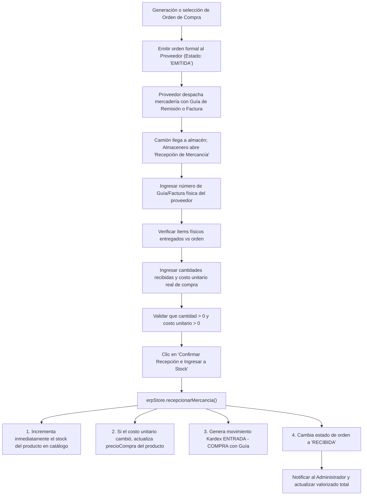

#### B. Tareas Completas del Flujo
- **T12.1 (Revisión Física en Muelle):** Cotejo de cajas, bultos y precintos contra el albarán del transportista.
- **T12.2 (Control de Costos):** Si el proveedor incrementó el precio de costo, el sistema actualiza `precioCompra` en el catálogo para recalcular márgenes futuros.
- **T12.3 (Incremento Directo en Almacén):** Aumento inmediato de las unidades vendibles disponibles para el POS.
- **T12.4 (Asiento en Kardex):** Registro formal de entrada con número de comprobante del proveedor.
- **T12.5 (Liquidación de la Orden):** Cierre de la orden de compra pendiente, evitando duplicidad de ingresos.

---

### FLUJO 13: Registro de Gastos Operativos y Gestión de Clientes

#### A. Diagrama de Flujo
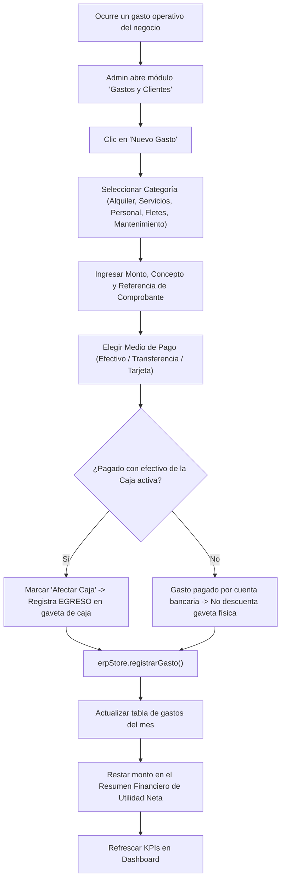

#### B. Tareas Completas del Flujo
- **T13.1 (Categorización):** Clasificación del gasto para análisis contable posterior.
- **T13.2 (Discriminación de Origen de Fondos):** Definir si el dinero salió de la gaveta del cajero (afecta el arqueo de hoy) o de cuentas maestras del negocio.
- **T13.3 (Impacto Financiero):** El gasto se contabiliza dentro de los egresos operativos del mes para el cálculo de la Utilidad Neta.
- **T13.4 (Gestión de Cartera de Clientes):** Creación y mantenimiento de clientes con RUC/DNI para agilizar su selección en POS y seguimiento de líneas de crédito.

---

### FLUJO 14: Liquidación Tributaria SUNAT, Balances y Diagnóstico IA

#### A. Diagrama de Flujo
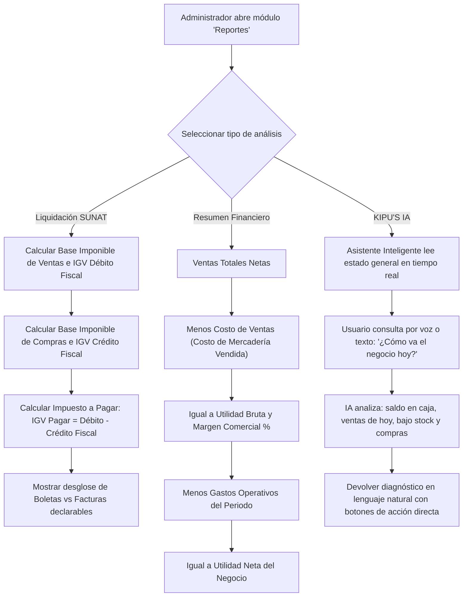

#### B. Tareas Completas del Flujo
- **T14.1 (Consolidación Fiscal SUNAT):** Cruce entre comprobantes de venta emitidos (`F001`, `B001`) contra facturas de compras registradas para anticipar el pago de impuestos ante SUNAT.
- **T14.2 (Estado de Resultados Integral):** Cálculo automático en cascada:
  $$\text{Ventas Netas} - \text{Costo de Ventas} = \text{Utilidad Bruta}$$
  $$\text{Utilidad Bruta} - \text{Gastos Operativos} = \text{Utilidad Neta}$$
- **T14.3 (Exportación):** Generación de archivos CSV tabulares para la contabilidad externa.
- **T14.4 (Asistencia Proactiva KIPU'S IA):** Motor heurístico local que detecta anomalías (ej. caja con descuadre, productos estrella sin stock o gastos excesivos) y sugiere rutas de solución con un solo clic.

---

## 4. Matriz de Responsabilidades por Rol (RACI)

La siguiente tabla resume qué rol ejecuta, supervisa o tiene restringida la participación en cada uno de los 14 flujos:

| N° | Flujo Operativo | Dueño / Administrador | Almacenero | Cajero |
| :---: | :--- | :---: | :---: | :---: |
| **01** | Autenticación y Control de Rutas | **A** (Responsable Total) | **R** (Usuario de Almacén) | **R** (Usuario de Caja) |
| **02** | Detección de Inactividad (15 min) | **R** (Aplica) | **R** (Aplica) | **R** (Aplica) |
| **03** | Venta POS y Cobro Multimedio | **A** (Supervisa/Audita) | **I** (Informativo - No opera) | **R** (Operador Principal) |
| **04** | Cotizaciones y Pedidos | **A** (Aprueba) | **I** (Prepara pedido) | **R** (Emite) |
| **05** | Devolución y Anulación | **A** (Autoriza) | **C** (Recibe artículo devuelto) | **R** (Registra devolución) |
| **06** | Ciclo de Caja (Apertura/Cierre) | **A** (Controla todas las cajas) | **I** (Sin acceso) | **R** (Opera su turno) |
| **07** | Arqueo y Auditoría de Gaveta | **R** (Auditor) | **I** (Sin acceso) | **C** (Auditado) |
| **08** | Catálogo y Escáner de Códigos | **A** (Define precios/alta) | **R** (Escanea y cataloga) | **I** (Consulta en POS) |
| **09** | Kardex Continuo y Semáforo | **A** (Supervisa) | **R** (Control diario) | **I** (Solo stock en POS) |
| **10** | Auditoría y Ajuste de Conteo | **A** (Valida mermas) | **R** (Cuenta en estante) | **I** (Sin acceso) |
| **11** | Sugerencia Inteligente de Compra | **A** (Decide inversión) | **R** (Sugiere reposición) | **I** (Sin acceso) |
| **12** | Recepción de Mercancía | **A** (Revisa costos) | **R** (Recepciona en muelle) | **I** (Sin acceso) |
| **13** | Gastos Operativos y Clientes | **R** (Registra gastos) | **I** (Sin acceso a gastos) | **R** (Registra cliente) |
| **14** | SUNAT, Balances y KIPU'S IA | **R** (Uso exclusivo) | **C** (Solo reporte inventario) | **I** (Sin acceso) |

*Leyenda: **R** = Realiza / Ejecuta; **A** = Aprueba / Administra; **C** = Consultado / Colabora; **I** = Informativo / Solo lectura según permisos.*

---

## 5. Mapeo con el Código Fuente

| Flujo | Páginas y Vistas Principales | Servicios y Tiendas de Datos | Modales y Componentes Clave |
| :---: | :--- | :--- | :--- |
| **01** | `LoginPage.tsx`, `router.tsx` | `authService.ts`, `sessionStore.ts` | `ProtectedRoute.tsx`, `AppSidebar.tsx` |
| **02** | `AppLayout.tsx`, `AuthContext.tsx` | `sessionStore.ts` | `sessionStore.spec.ts` |
| **03** | `VentasPage.tsx`, `PosTerminalView.tsx` | `erpStore.ts` (`emitirVenta`) | `CobroModal.tsx`, `CameraPreview.tsx` |
| **04** | `CotizacionesView.tsx`, `PedidosView.tsx` | `erpStore.ts` (`crearCotizacion`) | `VentaDetalleModal.tsx` |
| **05** | `VentasHistorialView.tsx` | `erpStore.ts` (`registrarDevolucion`) | `DevolucionesView.tsx` |
| **06** | `CajaPage.tsx`, `MiCajaView.tsx` | `erpStore.ts` (`abrirCaja`, `cerrarCaja`) | `AbrirCajaDialog.tsx`, `CierreCajaDialog.tsx` |
| **07** | `AuditoriaCajaView.tsx` | `erpStore.ts` (`registrarArqueo`) | `ArqueoConteoDialog.tsx` |
| **08** | `InventarioPage.tsx` | `productosService.ts`, `barcodeCatalogService.ts` | `ProductoFormDialog.tsx`, `EscanerProductoModal.tsx` |
| **09** | `MovementTable.tsx`, `InventoryTable.tsx`| `inventarioService.ts`, `erpStore.ts` | `ProductInventoryDetail.tsx` |
| **10** | `PhysicalInventoryTable.tsx`, `AdjustmentTable.tsx` | `inventarioService.ts` (`aplicarAjustesFisicos`) | `AuditoriaConteoDialog.tsx`, `AdjustmentForm.tsx` |
| **11** | `ComprasPage.tsx` | `sugerenciaComprasService.ts` | `RecomendacionComprasModal.tsx` |
| **12** | `ComprasPage.tsx`, `ProveedoresPage.tsx` | `comprasService.ts`, `erpStore.ts` | `RecepcionMercanciaDialog.tsx`, `NuevaCompraDialog.tsx` |
| **13** | `GastosPage.tsx`, `ClientesPage.tsx` | `gastosService.ts`, `clientesService.ts` | `NuevoGastoDialog.tsx`, `NuevoClienteDialog.tsx` |
| **14** | `ReportesPage.tsx`, `KipusIaPage.tsx` | `reportesService.ts`, `kipusIaService.ts` | `LiquidacionSunatTab.tsx`, `ResumenFinancieroTab.tsx` |
