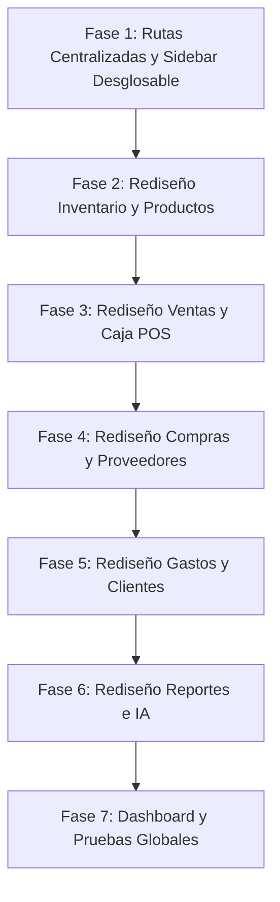

# Plan Maestro de Rediseño Integral de UI/UX — KIPU'S ERP
## Reorganización Ergonómica, Descomposición de Monolitos y Navegación Multirrol para el Administrador y Perfiles Compartidos

> **Versión:** 2.0  
> **Fecha:** 15 de Noviembre de 2026  
> **Aplicación:** KIPU'S ERP (Frontend Web & Desktop Shell)  
> **Marco Teórico:** 10 Heurísticas de Usabilidad de Jakob Nielsen, Leyes de la Psicología de la Gestalt, Principios de Diseño KIPU'S UI para el Retail y MYPEs peruanas.

---

## 1. Diagnóstico de la Situación Actual y Justificación

Actualmente, el rol de **Administrador / Dueño** concentra el control de todo el sistema. No obstante, varias de las pantallas principales sufren de:
1. **Sobrecarga Cognitiva (Visual Clutter):** Páginas monolíticas de más de 500 a 1,100 líneas de código (`ProductosPage.tsx` con 1,111 líneas, `InventarioPage.tsx` con 553 líneas, `ComprasPage.tsx` con 511 líneas) donde se mezclan filtros, tablas, gráficos, formularios y modales sin una separación temática nítida.
2. **Navegación Plana sin Jerarquía:** Menús del Sidebar que no reflejaban las sub-operaciones reales del negocio, forzando al usuario a entrar a una página y buscar tabs internos pequeños o confusos.
3. **Módulos Compartidos Inconsistentes:** Vistas utilizadas tanto por el Administrador como por Almaceneros o Cajeros (como Inventario, Ventas o Clientes) que en ocasiones mostraban información sensible de costos a cajeros o desaprovechaban la especialización de roles.
4. **Falta de Acordeones / Desglose:** Menús laterales estáticos donde el usuario no podía plegar ni desplegar secciones para despejar su espacio de trabajo.

Este plan define la reorganización **completa de todos los menús del ERP** disponibles para el rol de **Administrador**, identificando explícitamente cuáles se comparten con los roles operativos (`Cajero`, `Almacenero`, `Supervisor`) y dotando a cada módulo de una arquitectura modular basada en componentes desacoplados, submenús desplegables y controles contextuales.

---

## 2. Matriz de Roles y Módulos Compartidos

| Módulo Principal | Submenús Propuestos (Sidebar) | Rol Administrador | Rol Almacenero | Rol Cajero | Propósito y Ergonomía |
|---|---|:---:|:---:|:---:|---|
| **1. Inicio** | Directo al Dashboard ejecutivo | **Total** | Vista Almacén | Vista Turno | KPIs operativos del día, alertas inmediatas de stock y caja. |
| **2. Ventas y caja** | • Punto de Venta (POS) • Historial de Comprobantes • Caja y Turnos • Pedidos y Cotizaciones | **Total** | ❌ Sin acceso | **Operativo** | Máxima velocidad de digitación, prevención de errores en facturación y arqueo ciego. |
| **3. Inventario** | • Catálogo de Productos • Control de Stock y Ajustes • Kardex y Movimientos • Categorías y Unidades | **Total** | **Operativo** | ❌ Solo consulta rápida | Visibilidad de inventario físico, trazabilidad PEPS y alertas de quiebre. |
| **4. Compras y prov.** | • Órdenes de Compra • Recepción de Mercadería • Directorio de Proveedores • Cuentas por Pagar | **Total** | Recepción | ❌ Sin acceso | Reabastecimiento comercial, control de costos y cuentas pendientes. |
| **5. Gastos y clientes** | • Gastos Operativos • Directorio de Clientes • Cuentas por Cobrar (Fiados) | **Total** | ❌ Sin acceso | Solo Clientes | Separación clara entre egresos del negocio y cartera de clientes a crédito. |
| **6. Reportes e IA** | • Ventas y Rentabilidad • Reportes SUNAT / PLE • Valorización de Stock • Asistente KIPU'S IA | **Total** | Solo Stock | ❌ Sin acceso | Análisis estratégico, cumplimiento tributario e inteligencia predictiva. |
| **7. Administración** | • Usuarios y Roles • Empresa y Sucursales • Facturación y SUNAT • Hardware y POS • Parámetros del Sistema | **Total** | ❌ Sin acceso | ❌ Sin acceso | *(Fase previa ya implementada)*. Configuración fiscal, sucursales y hardware. |

---

## 3. Principios de Diseño UI/UX Aplicados

### A. Heurísticas de Usabilidad de Jakob Nielsen
* **H1: Visibilidad del estado del sistema:** Indicadores en tiempo real (semáforo de caja abierta, estado de conexión a SUNAT, insignias de stock crítico en ámbar/rojo).
* **H2: Correspondencia con el mundo real:** Vocabulario comercial y tributario peruano (Boleta, Factura, Nota de Crédito, Arqueo de caja, Fiado, RUC, DNI, IGV 18%, Kardex).
* **H3: Control y libertad del usuario:** Reemplazo de modales intrusivos por *Sheets* (paneles deslizables laterales) que permiten cancelar, volver o mantener visible la información de fondo.
* **H4: Consistencia y estándares:** Botón primario violeta (`#431B94`), variantes secundarias en `outline`, etiquetas de estado uniformes (`StatusBadge`) y números con fuente monoespaciada tabular (`tabular-nums font-mono`).
* **H5: Prevención de errores:** Validaciones automáticas en vivo (RUC de 11 dígitos, DNI de 8 dígitos, montos mayores a cero), confirmaciones con doble paso para anulaciones de comprobantes o cierres de caja.
* **H6: Reconocimiento antes que recuerdo:** Filtros en chips con contadores numéricos integrados (ej. `Todos (142)`, `Stock Bajo (8)`), autocompletado en búsquedas con debounce.
* **H7: Flexibilidad y atajos de teclado:** Atajos directos para operaciones frecuentes (`F2` buscar producto, `F4` cobrar comprobante, `ESC` cerrar paneles).
* **H8: Estética y minimalismo:** Eliminación de tarjetas gigantes redundantes que empujan las tablas hacia abajo; aprovechamiento óptimo de pantallas de 1366x768px.
* **H9: Ayuda para diagnosticar errores:** Mensajes de alerta claros, contextuales y con sugerencias de solución en español.
* **H10: Ayuda y documentación contextual:** Previsualizaciones interactivas (como el ticket térmico en tiempo real) y sugerencias asistidas de compras y stock.

### B. Leyes de la Psicología de la Gestalt
* **Ley de Proximidad:** Acciones agrupadas junto a los elementos que modifican (ej. botón de editar lote junto al stock del producto).
* **Ley de Similitud:** Todos los filtros tienen el mismo estilo visual y tamaño; las acciones destructivas comparten el color destructivo suave.
* **Ley de Región Común (Cerramiento):** Uso de tarjetas con bordes sutiles para delimitar zonas de trabajo independientes sin saturar la vista con sombras pesadas.
* **Ley de Figura y Fondo:** Fondos limpios que resaltan tablas y paneles activos con desenfoque de baja intensidad en drawers.

---

## 4. Fases de Trabajo y Checklists Detallados

---

### **Fase 1: Arquitectura de Navegación Global y Submenús Desplegables**
> **Objetivo:** Extender la experiencia de submenús desglosables (`Collapsible / Accordion`) del Sidebar a todos los módulos del Administrador y roles operativos en `routes.ts` y `AppSidebar.tsx`.

- [ ] **Tarea 1.1: Actualización de Rutas Centralizadas (`constants/routes.ts`)**
  - [ ] Declarar `subItems` para el módulo **Inventario**: `Catálogo de Productos`, `Control de Stock`, `Kardex y Movimientos`, `Categorías y Unidades`.
  - [ ] Declarar `subItems` para el módulo **Compras y proveedores**: `Órdenes de Compra`, `Recepción de Mercadería`, `Directorio de Proveedores`, `Cuentas por Pagar`.
  - [ ] Declarar `subItems` para el módulo **Gastos y clientes**: `Gastos Operativos`, `Directorio de Clientes`, `Cuentas por Cobrar (Fiados)`.
  - [ ] Declarar `subItems` para el módulo **Reportes**: `Ventas y Rentabilidad`, `Reportes SUNAT`, `Valorización de Stock`, `KIPU'S IA`.
  - [ ] Homologar las rutas derivadas para los roles de `Cajero` y `Almacenero`.

- [ ] **Tarea 1.2: Mejora del Acordeón en el Sidebar (`AppSidebar.tsx`)**
  - [ ] Soporte universal de apertura/plegado suave para todos los módulos que cuenten con `subItems`.
  - [ ] Persistencia ligera del estado de despliegue en memoria o `sessionStorage` para no cerrarse tras una recarga accidental.
  - [ ] Indicador numérico (badge) sutil en submenús cuando existan alertas pendientes (ej. `Stock Bajo: 4` o `Cuentas por Cobrar: 2`).

---

### **Fase 2: Rediseño del Módulo `Inventario y Productos`**
> **Objetivo:** Descomponer los monolitos de `ProductosPage.tsx` (1,111 líneas) e `InventarioPage.tsx` (553 líneas) en vistas especializadas, ergonómicas y sin sobrecarga visual.

- [ ] **Tarea 2.1: Descomposición en Vistas Modulares (`features/inventario/components/`)**
  - [ ] Crear `CatalogoProductosView.tsx`: Tabla compacta de alta densidad con buscador reactivo, filtro por categoría, chips de estado (`Stock bajo`, `Agotado`) y acciones rápidas por fila.
  - [ ] Crear `ControlStockView.tsx`: Panel enfocado en existencias por almacén/sucursal, alertas de vencimiento, stock mínimo y ajuste directo de inventario.
  - [ ] Crear `KardexMovimientosView.tsx`: Historial de entradas, salidas, mermas y traslados con números de documento de origen, costo unitario y saldo valorizado.
  - [ ] Crear `CategoriasUnidadesView.tsx`: Administración ágil de categorías, marcas y unidades de medida (UND, KG, LT, CAJA, DOC) con creación inline.

- [ ] **Tarea 2.2: Rediseño del Formulario de Producto con `Sheet` Lateral**
  - [ ] Migrar el formulario modal centrado a un `ProductoFormSheet.tsx` lateral deslizable.
  - [ ] Secciones colapsables: Datos básicos (Nombre, SKU, Código de barras), Precios e Impuestos (Costo compra, Precio venta minorista/mayorista, Afectación IGV), y Control de Stock (Mínimo, Máximo, Ubicación).
  - [ ] Integrar generador y lector de código de barras sin romper la vista principal.

- [ ] **Tarea 2.3: Vista Unificada del Módulo (`InventarioPage.tsx`)**
  - [ ] Reducir `InventarioPage.tsx` a un orquestador limpio (< 150 líneas) gobernado por el parámetro `?tab=...` sincronizado con los submenús del sidebar.

---

### **Fase 3: Rediseño del Módulo `Ventas y Caja`**
> **Objetivo:** Maximizar la velocidad operativa en el Punto de Venta (POS) y organizar las operaciones secundarias (Comprobantes, Caja, Cotizaciones) sin estorbar la venta continua.

- [ ] **Tarea 3.1: Ergonomía de Pantalla Dividida en el POS (`PosTerminalView.tsx`)**
  - [ ] Columna Izquierda (60%): Catálogo táctil con pestañas de categorías rápidas, barra de búsqueda con debounce y lector de códigos de barras siempre enfocado.
  - [ ] Columna Derecha (40%): Ticket de venta activo con teclado numérico virtual para pantallas táctiles, cambio de cantidades rápido (`+`, `-`) y total en tipografía grande de alto contraste.
  - [ ] Atajos de teclado visibles (`F2` Buscar, `F4` Cobrar, `F8` Limpiar carrito) para cajeros experimentados.

- [ ] **Tarea 3.2: Módulo de Comprobantes e Historial (`VentasHistorialView.tsx`)**
  - [ ] Rediseño de la tabla de comprobantes emitidos: Fecha/Hora, Tipo (Boleta/Factura), Serie-Correlativo, Cliente, Total, Estado SUNAT (`Aceptado`, `Rechazado`, `Pendiente`) y Acciones.
  - [ ] Drawer lateral para ver el detalle del comprobante y reimpresión térmica en un solo clic.
  - [ ] Modal de anulación con motivo obligatorio según normativa SUNAT y generación automática de Nota de Crédito.

- [ ] **Tarea 3.3: Módulo de Caja y Turnos (`CajaPage.tsx` / `CajaTurnosView.tsx`)**
  - [ ] Semáforo superior de estado: Caja abierta por [Usuario] a las [Hora] con saldo inicial de [S/ XX.XX].
  - [ ] Registro rápido de ingresos/egresos menores (Caja chica / gastos diarios menores).
  - [ ] Flujo de arqueo ciego para cierre de turno: el cajero cuenta y digita el efectivo real antes de comparar con el sistema para evitar descuadres intencionales.

- [ ] **Tarea 3.4: Submenú de Pedidos y Cotizaciones (`PedidosCotizacionesView.tsx`)**
  - [ ] Separar las cotizaciones y pedidos pendientes del historial de ventas terminadas.
  - [ ] Botón de conversión directa: `[ Convertir Cotización en Venta POS ]` con un solo clic.

---

### **Fase 4: Rediseño del Módulo `Compras y Proveedores`**
> **Objetivo:** Ordenar el flujo de compras de mercadería desde la orden hasta la recepción física y registro de factura.

- [ ] **Tarea 4.1: Descomposición Modular (`features/compras/components/`)**
  - [ ] Crear `OrdenesCompraView.tsx`: Listado de órdenes con badges de estado (`Borrador`, `Aprobada`, `Recibida parcial`, `Completada`).
  - [ ] Crear `RecepcionMercaderiaView.tsx`: Pantalla de verificación contra guía de remisión / factura del proveedor con actualización automática de stock y costo promedio.
  - [ ] Crear `ProveedoresDirectorioView.tsx`: Directorio de proveedores con consulta de RUC, contacto directo, plazo de crédito y catálogo de productos suministrados.
  - [ ] Crear `CuentasPorPagarView.tsx`: Calendario/tabla de facturas de proveedores por vencer con alertas de pago prioritario.

- [ ] **Tarea 4.2: Asistente de Reabastecimiento KIPU'S**
  - [ ] Tarjeta compacta superior que agrupe sugerencias de compra basadas en productos por debajo del stock mínimo, con botón `[ Generar Orden Sugerida ]`.

---

### **Fase 5: Rediseño del Módulo `Gastos y Clientes`**
> **Objetivo:** Separar limpiamente el control de egresos de la administración de clientes y cuentas por cobrar (fiados).

- [ ] **Tarea 5.1: Módulo de Gastos Operativos (`GastosOperativosView.tsx`)**
  - [ ] Formulario rápido tipo drawer: Categoría (Servicios, Alquiler, Planilla, Logística, Mantenimiento), Monto, Método de pago, Comprobante y Observaciones.
  - [ ] Tarjeta condensada de egresos del mes categorizados con porcentaje de impacto sobre las ventas.

- [ ] **Tarea 5.2: Directorio de Clientes (`ClientesDirectorioView.tsx`)**
  - [ ] Tabla de clientes con búsqueda por DNI/RUC, teléfono, tipo de cliente (Minorista/Mayorista) y total acumulado de compras.
  - [ ] Drawer lateral de cliente con historial de compras previas y comprobantes asociados.

- [ ] **Tarea 5.3: Control de Créditos y Cuentas por Cobrar (Fiados)**
  - [ ] Vista dedicada a ventas al crédito: Cliente, saldo adeudado, fecha límite de pago y botón `[ Registrar Abono ]`.
  - [ ] Generación automática de comprobante de pago de abono en ticketera térmica.

---

### **Fase 6: Rediseño del Módulo `Reportes e Inteligencia KIPU'S IA`**
> **Objetivo:** Transformar pantallas densas de reportes en paneles ejecutivos claros con visualizaciones intuitivas y cumplimiento tributario.

- [ ] **Tarea 6.1: Reportes de Ventas y Rentabilidad (`ReporteVentasRentabilidadView.tsx`)**
  - [ ] Gráficos limpios con selector de período rápido: Hoy, Ayer, Esta semana, Este mes, Personalizado.
  - [ ] Tabla de productos más vendidos bajo el principio de Pareto (Top 20% que genera el 80% de ingresos).
  - [ ] Indicador de Margen Bruto real (Ventas - Costos de Compra).

- [ ] **Tarea 6.2: Reportes Tributarios SUNAT (`ReporteSunatTributarioView.tsx`)**
  - [ ] Resumen mensual de Ventas Gravadas, Exoneradas e IGV acumulado (para declaración mensual Formulario 621 SUNAT).
  - [ ] Botón de exportación en formato oficial Excel y TXT para libros electrónicos (PLE / SIRE).

- [ ] **Tarea 6.3: Valorización de Inventario (`ReporteInventarioValorizadoView.tsx`)**
  - [ ] Capital total inmovilizado en stock (por costo de compra y por precio de venta proyectado).
  - [ ] Clasificación ABC de rotación de mercadería.

- [ ] **Tarea 6.4: Asistente KIPU'S IA (`KipusIaAssistantView.tsx`)**
  - [ ] Chat interactivo integrado y tarjetas de insights accionables: predicción de compras para la siguiente semana, productos sin rotación y alertas de discrepancias en caja.

---

### **Fase 7: Consolidación del `Inicio (Dashboard)` y Control de Calidad Transversal**
> **Objetivo:** Integrar el Dashboard ejecutivo para el Administrador y garantizar que todas las vistas cumplan con cero errores y máxima responsividad.

- [ ] **Tarea 7.1: Rediseño del Dashboard Ejecutivo (`DashboardPage.tsx`)**
  - [ ] 4 KPIs esenciales arriba: Ventas del día, Ganancia estimada, Estado de Caja, y Alertas críticas.
  - [ ] Accesos directos a operaciones más comunes según rol.
  - [ ] Gráfico de tendencia horaria de ventas para identificar picos de afluencia de clientes.

- [ ] **Tarea 7.2: Control de Calidad Transversal y Verificación**
  - [ ] Ejecución de `pnpm run typecheck` asegurando cero errores de compilación TypeScript en todo el proyecto.
  - [ ] Ejecución de la suite completa de pruebas con `pnpm test`.
  - [ ] Verificación de accesibilidad visual (contraste WCAG AA, tamaños de fuente legibles en pantallas de mostrador).
  - [ ] Verificación de navegación mediante URLs directas (Deep linking en todos los submenús).

---

## 5. Cronograma y Orden de Ejecución Sugerido

---

## 6. Criterios de Aceptación para Considerar el Plan Concluido

1. **Jerarquía Visual Clara:** Ninguna pantalla debe contener más de 6 a 8 campos visibles de formulario simultáneamente sin agrupar.
2. **Submenús Plegables:** Cada sección principal con más de 2 operaciones clave debe contar con submenús en el Sidebar con flecha de despliegue/pliegue.
3. **Desacoplamiento de Código:** Ningún componente de página (`*Page.tsx`) debe superar las 180 líneas de código; deben actuar únicamente como orquestadores de vistas modulares.
4. **Cero Regresiones:** El 100% de las pruebas unitarias existentes deben pasar con éxito y `tsc` debe arrojar 0 advertencias o errores de tipado.
5. **Ergonomía de Mostrador:** Los flujos críticos (cobro en POS, búsqueda de productos y arqueo de caja) deben operarse fluidamente en pantallas táctiles y con atajos de teclado sin depender exclusivamente del mouse.
